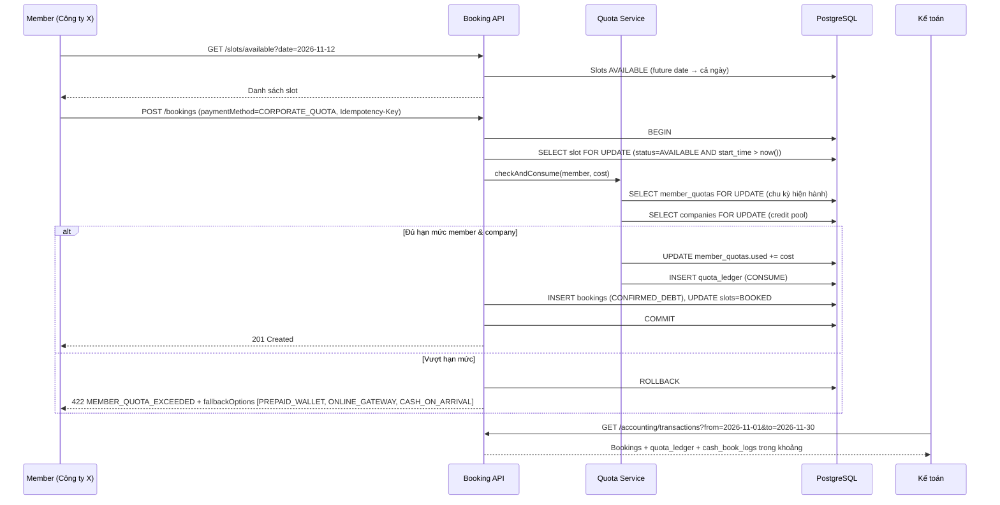

# BA Analysis — Member đặt phòng tương lai → Trừ hạn mức → Kế toán đối soát theo khoảng ngày

**Phạm vi:** Module 1 (B2B Quota), Module 2 (Calendar), Module 3 (Finance & Reconciliation)
**Baseline:** BRD v1.4, `src/database/schema_v1.sql`, `src/services/BookingService.ts`
**Ngày phân tích:** 2026-11-08 · **Múi giờ nghiệp vụ chuẩn:** `Asia/Ho_Chi_Minh` (UTC+7)

---

## 1. Usecase Analysis

### 1.1. Actors
| Actor | Role hệ thống | Hành động chính |
|---|---|---|
| Corporate Admin / Kế toán nội bộ | `ADMIN` / `ACCOUNTANT`* | Tạo công ty, thành viên, cấu hình hạn mức |
| Thành viên doanh nghiệp | `MEMBER` (`company_id` NOT NULL) | Tra cứu lịch, đặt phòng |
| Lễ tân | `STAFF` | Check-in/out, thu tiền mặt khi vượt hạn mức |
| Kế toán | `ACCOUNTANT`* | Đối soát theo `[Từ ngày] - [Đến ngày]` |
| Scheduler | System job | Reset hạn mức theo chu kỳ |

\* `ACCOUNTANT` hiện **chưa có** trong `user_role_enum` (xem Gap G-07).

### 1.2. Main Flow (Happy Path)


### 1.3. Alternate / Exception Flows
| Mã | Tình huống | Xử lý |
|---|---|---|
| A1 | Vượt hạn mức member | 422 `MEMBER_QUOTA_EXCEEDED`, trả về `remaining` và `fallbackOptions`. Không giữ slot. |
| A2 | Member đủ nhưng company pool (credit_limit) không đủ | 422 `CREDIT_LIMIT_EXCEEDED`. Company là trần cứng. |
| A3 | Thanh toán hỗn hợp (còn 1h quota, đặt 2h) | **Mặc định: từ chối toàn phần** (không split). Split-payment là CR riêng — cần PO xác nhận. |
| A4 | Hủy trước hạn (≥ 24h) | Hoàn quota: `quota_ledger(type=RELEASE)` vào **chu kỳ của booking gốc**. Nếu chu kỳ đã reset → không cộng vào chu kỳ mới (tránh “đẻ” quota). |
| A5 | Hủy muộn / No-show | Không hoàn quota (theo `cancellation_policy.md`). |
| A6 | Check-out trễ (overtime) | Loại HOURS: tiêu hao thêm `ceil(overtime/15p)*0.25h`; nếu vượt quota → phát sinh khoản thu bổ sung (cash/ví). |
| A7 | Reset chu kỳ trùng thời điểm đặt | Reset và consume cùng khóa `member_quotas FOR UPDATE` → tuần tự hóa. |
| A8 | Booking tương lai nằm ở chu kỳ sau | Tiêu hao vào **chu kỳ chứa `slot.start_time`**, không phải chu kỳ hiện tại (quyết định cần PO confirm — xem §5). |
| A9 | Thành viên bị khóa / công ty `is_active=false` | 403 `MEMBER_INACTIVE` / `COMPANY_INACTIVE`. |

### 1.4. Quy tắc tính “cost” theo loại hạn mức
| `quota_type` | Đơn vị | Cost của 1 booking |
|---|---|---|
| `CREDIT` | VND | `total_amount` sau giá động (peak/weekend/holiday) |
| `BOOKINGS` | lượt | `1` |
| `HOURS` | giờ (DECIMAL 6,2) | `(end_time - start_time)` giờ đặt; điều chỉnh theo actual khi check-out (A6) |

> Một member có thể có **nhiều loại hạn mức đồng thời** (vd. 30h **và** 10 lượt/tháng). Booking hợp lệ khi **tất cả** quota đang active đều đủ.

---

## 2. Database & Logic Mapping

### 2.1. Bảng mới / thay đổi (DDL đề xuất — migration `V1.5__corporate_quota.sql`)
```sql
-- Mở rộng companies
ALTER TABLE companies
  ADD COLUMN contact_name   VARCHAR(150),
  ADD COLUMN contact_email  VARCHAR(255),
  ADD COLUMN contact_phone  VARCHAR(20),
  ADD COLUMN billing_address TEXT,
  ADD COLUMN pricing_policy_id UUID,          -- FK pricing_policies
  ADD COLUMN contract_no    VARCHAR(50),
  ADD COLUMN contract_start DATE,
  ADD COLUMN contract_end   DATE;

CREATE TYPE quota_type_enum  AS ENUM ('CREDIT','BOOKINGS','HOURS');
CREATE TYPE reset_cycle_enum AS ENUM ('WEEKLY','MONTHLY','MANUAL');
CREATE TYPE quota_tx_enum    AS ENUM ('CONSUME','RELEASE','ADJUST','RESET','OVERTIME');

-- Cấu hình hạn mức theo member
CREATE TABLE member_quotas (
  id            UUID PRIMARY KEY DEFAULT gen_random_uuid(),
  user_id       UUID NOT NULL REFERENCES users(id),
  company_id    UUID NOT NULL REFERENCES companies(id),
  quota_type    quota_type_enum NOT NULL,
  quota_limit   DECIMAL(15,2) NOT NULL CHECK (quota_limit >= 0),
  quota_used    DECIMAL(15,2) NOT NULL DEFAULT 0 CHECK (quota_used >= 0),
  reset_cycle   reset_cycle_enum NOT NULL DEFAULT 'MONTHLY',
  period_start  DATE NOT NULL,     -- chu kỳ hiện hành (giờ VN)
  period_end    DATE NOT NULL,     -- inclusive
  is_active     BOOLEAN NOT NULL DEFAULT TRUE,
  updated_by    UUID REFERENCES users(id),
  updated_at    TIMESTAMPTZ NOT NULL DEFAULT now(),
  CONSTRAINT chk_quota_not_exceeded CHECK (quota_used <= quota_limit),
  CONSTRAINT uq_member_quota UNIQUE (user_id, quota_type)
);

-- Sổ cái hạn mức (bất biến, phục vụ báo cáo & đối soát)
CREATE TABLE quota_ledger (
  id              UUID PRIMARY KEY DEFAULT gen_random_uuid(),
  member_quota_id UUID NOT NULL REFERENCES member_quotas(id),
  user_id         UUID NOT NULL REFERENCES users(id),
  company_id      UUID NOT NULL REFERENCES companies(id),
  booking_id      UUID REFERENCES bookings(id),
  tx_type         quota_tx_enum NOT NULL,
  amount          DECIMAL(15,2) NOT NULL,       -- + consume / - release
  used_before     DECIMAL(15,2) NOT NULL,
  used_after      DECIMAL(15,2) NOT NULL,
  period_start    DATE NOT NULL,
  reason          TEXT,
  performed_by    UUID REFERENCES users(id),    -- NULL = scheduler
  idempotency_key VARCHAR(100) UNIQUE NOT NULL,
  created_at      TIMESTAMPTZ NOT NULL DEFAULT now()
);
CREATE INDEX idx_quota_ledger_user_time    ON quota_ledger (user_id, created_at DESC);
CREATE INDEX idx_quota_ledger_company_time ON quota_ledger (company_id, created_at);

-- Check-in / check-out thực tế
ALTER TABLE bookings
  ADD COLUMN actual_check_in  TIMESTAMPTZ,
  ADD COLUMN actual_check_out TIMESTAMPTZ,
  ADD COLUMN quota_consumed   JSONB;   -- {"HOURS":2,"BOOKINGS":1}

-- Phương thức thanh toán mới
ALTER TYPE payment_method_enum ADD VALUE 'CORPORATE_QUOTA';
ALTER TYPE user_role_enum ADD VALUE 'ACCOUNTANT';

-- Index phục vụ lọc kế toán theo ngày
CREATE INDEX idx_bookings_created_at   ON bookings (created_at);
CREATE INDEX idx_payments_created_at   ON payments (created_at);
CREATE INDEX idx_cash_book_created_at  ON cash_book_logs (created_at);
```

### 2.2. Logic trừ hạn mức (trong cùng transaction với booking)
```sql
-- 1) Khóa & xác thực slot (chặn quá khứ ở tầng server)
SELECT id, start_time, end_time FROM slots
 WHERE id = $slot_id AND status = 'AVAILABLE' AND start_time > now()
 FOR UPDATE;                                   -- 0 rows → 409 SLOT_UNAVAILABLE

-- 2) Khóa tất cả quota active của member (thứ tự cố định theo id để tránh deadlock)
SELECT * FROM member_quotas
 WHERE user_id = $uid AND is_active
   AND ($slot_start AT TIME ZONE 'Asia/Ho_Chi_Minh')::date BETWEEN period_start AND period_end
 ORDER BY id FOR UPDATE;

-- 3) Với mỗi quota: nếu quota_used + cost > quota_limit → ROLLBACK, 422
UPDATE member_quotas SET quota_used = quota_used + $cost, updated_at = now()
 WHERE id = $qid AND quota_used + $cost <= quota_limit
RETURNING quota_used;                          -- 0 rows → 422 (double-guard)

-- 4) Ghi ledger + booking + slot BOOKED → COMMIT
```

### 2.3. Reset tự động (Scheduler 00:00 giờ VN)
```sql
UPDATE member_quotas q
   SET quota_used = 0,
       period_start = <next_start>, period_end = <next_end>
 WHERE reset_cycle IN ('WEEKLY','MONTHLY')
   AND period_end < (now() AT TIME ZONE 'Asia/Ho_Chi_Minh')::date
RETURNING q.id;   -- mỗi dòng → INSERT quota_ledger(tx_type='RESET', idempotency_key = qid||':'||next_start)
```
- WEEKLY: Thứ Hai 00:00 → Chủ Nhật 23:59:59. MONTHLY: ngày 1 → ngày cuối tháng.
- Idempotency key theo `qid:period_start` → job chạy lại không reset 2 lần.

### 2.4. Báo cáo lịch sử sử dụng của 1 thành viên
```sql
SELECT b.booking_code, r.name AS room, s.start_time, s.end_time,
       b.booking_status, b.actual_check_in, b.actual_check_out,
       COALESCE(SUM(l.amount) FILTER (WHERE l.tx_type IN ('CONSUME','OVERTIME')),0)
     - COALESCE(SUM(-l.amount) FILTER (WHERE l.tx_type = 'RELEASE'),0) AS net_quota_consumed,
       q.quota_type
FROM bookings b
JOIN slots s  ON s.id = b.slot_id
JOIN rooms r  ON r.id = b.room_id
LEFT JOIN quota_ledger l ON l.booking_id = b.id
LEFT JOIN member_quotas q ON q.id = l.member_quota_id
WHERE b.user_id = $member_id
  AND b.created_at >= ($from::date)::timestamp AT TIME ZONE 'Asia/Ho_Chi_Minh'
  AND b.created_at <  (($to::date + 1))::timestamp AT TIME ZONE 'Asia/Ho_Chi_Minh'
GROUP BY b.id, r.name, s.start_time, s.end_time, q.quota_type
ORDER BY s.start_time DESC;
```
Bao gồm cả booking `CANCELLED*` (yêu cầu “thành công/hủy”).

### 2.5. Đối soát kế toán theo `[StartDate] - [EndDate]` (inclusive)
**Quy tắc chuẩn hóa (bắt buộc dùng chung toàn hệ thống):**
- Input: `from`, `to` dạng `YYYY-MM-DD` (ngày lịch VN). Validate `from <= to`, khoảng tối đa 366 ngày.
- Chuyển thành **nửa khoảng** `[from 00:00 VN, to+1 00:00 VN)` — KHÔNG dùng `BETWEEN ... 'to 23:59:59'` (mất bản ghi có mili-giây).

```sql
-- Tham số chung
--   $start_ts = ($from::date)::timestamp     AT TIME ZONE 'Asia/Ho_Chi_Minh'
--   $end_ts   = ($to::date + 1)::timestamp   AT TIME ZONE 'Asia/Ho_Chi_Minh'

-- (a) Giao dịch cổng thanh toán
SELECT ... FROM payments p
 WHERE p.created_at >= $start_ts AND p.created_at < $end_ts;

-- (b) Hóa đơn / booking phát sinh (theo ngày ghi nhận doanh thu)
SELECT ... FROM bookings b
 WHERE b.created_at >= $start_ts AND b.created_at < $end_ts
   AND b.booking_status NOT IN ('LOCKED_PENDING_ONLINE','EXPIRED');

-- (c) Lượt sử dụng hạn mức
SELECT ... FROM quota_ledger l
 WHERE l.created_at >= $start_ts AND l.created_at < $end_ts
   AND ($company_id IS NULL OR l.company_id = $company_id);

-- (d) Thu/chi tiền mặt — lọc theo shift_date (ngày ca VN) để khớp sổ giao ca
SELECT ... FROM cash_book_logs c
 WHERE c.shift_date BETWEEN $from::date AND $to::date;
```
> **Lưu ý thiết kế:** `cash_book_logs.shift_date` hiện mặc định `CURRENT_DATE` → phụ thuộc timezone của DB session. Phải set `timezone='Asia/Ho_Chi_Minh'` ở DB/role hoặc truyền `shift_date` tường minh từ app.

**API đề xuất:**
`GET /accounting/transactions?from=YYYY-MM-DD&to=YYYY-MM-DD&channel=ALL|CASH|MOMO|VNPAY|QUOTA|WALLET&companyId=&page=&size=`
`GET /companies/{id}/members/{memberId}/usage-history?from=&to=`

---

## 3. Cross-module Impact
| Thay đổi | Module 1 – Quota | Module 2 – Lịch trống | Module 3 – Kế toán |
|---|---|---|---|
| Booking `CORPORATE_QUOTA` thành công | `quota_used` tăng; ledger `CONSUME`; company `current_debt` tăng (nếu CREDIT) | Slot → `BOOKED`, biến mất khỏi lịch trống mọi kênh | Xuất hiện ở (b) + (c) trong ngày `created_at` |
| Vượt hạn mức → fallback CASH | Không đổi quota | Slot chỉ `BOOKED` sau khi thu tiền xong (không giữ slot trong lúc chuyển luồng → rủi ro mất slot, chấp nhận hoặc lock 5 phút — cần PO chọn) | Ghi `cash_book_logs CASH_IN_COLLECT` |
| Hủy booking | Ledger `RELEASE` (nếu đủ điều kiện) | Slot → `AVAILABLE` **chỉ khi** `start_time > now()` | Ghi nhận âm trong khoảng ngày của **ngày hủy**, không sửa ngày gốc |
| Admin chỉnh `quota_limit` xuống < `quota_used` | Cấm bằng CHECK → UI phải chặn, hoặc đổi sang trạng thái “tạm khóa” không đổi limit | Không ảnh hưởng booking đã có | Ledger `ADJUST` có `performed_by` |
| Reset chu kỳ | `quota_used=0` | Không | Ledger `RESET` (lọc ra khỏi báo cáo doanh thu, giữ trong báo cáo audit) |
| Check-out trễ | Ledger `OVERTIME` | Có thể đè slot kế tiếp → cảnh báo lễ tân | Phát sinh khoản thu bổ sung |
| Đổi timezone / chuẩn hóa ngày | — | Ranh giới “hôm nay” | Ranh giới khoảng lọc — **bắt buộc dùng chung util** |

---

## 4. Comprehensive Test Cases
| ID | Loại | Tiền điều kiện | Bước | Kết quả mong đợi |
|---|---|---|---|---|
| TC-Q01 | Happy | Member A (Cty X), HOURS 30h, used 18h. Hôm nay 2026-11-08 | Đặt 2026-11-12 13:00–15:00 | 201, `CONFIRMED_DEBT`; used = 20h; ledger CONSUME 2.00; slot BOOKED |
| TC-Q02 | Edge – vượt | BOOKINGS 12, used 12 | Đặt bất kỳ slot tương lai | 422 `MEMBER_QUOTA_EXCEEDED`, `remaining=0`, `fallbackOptions` có CASH; slot vẫn AVAILABLE |
| TC-Q03 | Edge – biên đúng bằng | CREDIT 15tr, used 14.3tr | Đặt phòng 700.000đ | 201 (`used == limit` hợp lệ); đặt tiếp 1đ → 422 |
| TC-Q04 | Concurrency | HOURS còn 2h | 2 request song song, mỗi cái 2h, khác slot | Đúng 1 thành công, 1 nhận 422; `quota_used` không vượt limit |
| TC-Q05 | Idempotency | — | Gửi lại cùng `Idempotency-Key` | Trả kết quả cũ, ledger chỉ 1 dòng |
| TC-Q06 | Reset | MONTHLY, used 30/30, ngày 2026-11-30 23:59 | Scheduler chạy 2026-12-01 00:00 (chạy 2 lần) | used = 0, 1 dòng RESET duy nhất |
| TC-Q07 | Hủy sau reset | Booking tạo T11 cho 2026-12-03, hủy ngày 2026-12-01 | Hủy | Không cộng quota vào chu kỳ T12 (theo A4/A8 đã chốt) |
| TC-C01 | Calendar today | Now 16:32 | GET slots hôm nay | Không có slot `start_time <= 16:32`; có 17:00, 19:00 |
| TC-C02 | Calendar future | — | GET slots 2026-11-12 | Đủ 6 khung 08:00–21:00 trừ slot đã BOOKED/MAINTENANCE |
| TC-F01 | Đối soát biên | Giao dịch lúc 2026-11-01 00:00:00 VN và 2026-11-30 23:59:59.999 VN | Lọc 01/11–30/11 | Cả 2 xuất hiện; giao dịch 2026-12-01 00:00:00 không xuất hiện |
| TC-F02 | Đối soát timezone | Giao dịch 2026-11-01 06:30 VN (= 2026-10-31 23:30 UTC) | Lọc 01/11–01/11 | Có xuất hiện (ngày VN, không phải UTC) |
| TC-F03 | Validate | — | from = 2026-11-10, to = 2026-11-01 | 400 `INVALID_DATE_RANGE`; UI không cho chọn |
| TC-F04 | Đối soát đầy đủ | Trong khoảng có: 1 MoMo, 1 cash, 1 quota, 1 hủy hoàn tiền mặt | Lọc | 4 nguồn hiển thị đủ; tổng cash = IN − OUT |

---

## 5. Open Questions (cần PO / Kế toán xác nhận)
1. **A3** — Có cho phép split-payment (phần quota + phần cash) không?
2. **A8** — Booking tương lai tiêu hao vào chu kỳ của ngày đặt hay ngày sử dụng? (Đề xuất: ngày sử dụng.)
3. Báo cáo doanh thu ghi nhận theo `created_at` (ngày phát sinh) hay `slot.start_time` (ngày sử dụng)? Ảnh hưởng trực tiếp WHERE của (b).
4. Hạn mức CREDIT của member có trừ đồng thời vào `companies.current_debt` không? (Đề xuất: có — company là pool tổng.)
5. Slot đang diễn ra (vd. 15:00–17:00 lúc 16:32) có cho đặt phần còn lại không? Hiện tại: ẩn.

