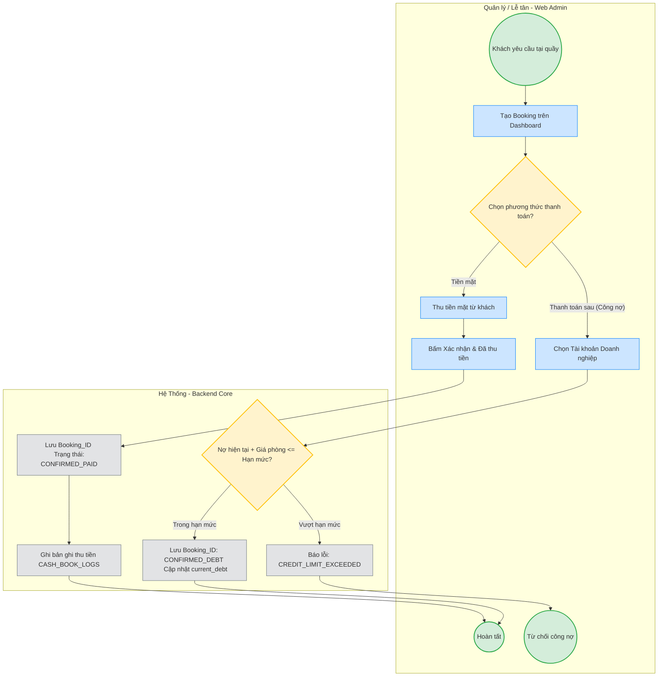

# TÀI LIỆU YÊU CẦU NGHIỆP VỤ (BRD)
**Dự án:** Smart Meeting Room Booking System (Hệ thống Đặt Phòng Họp Thông Minh)  
**Phiên bản:** v1.4 (Cập nhật sau Thẩm định & Phân tích Lỗ hổng Kiến trúc)

## 1. Bối cảnh và Thách thức (Business Problem)
Hiện tại, việc quản lý và đặt phòng họp tại các tòa nhà văn phòng/coworking space gặp các vấn đề:
*   **Xung đột lịch trình (Double-booking):** Đặt lịch thủ công thiếu cơ chế "khóa" thời gian thực.
*   **Phòng trống "ảo" & Găm giữ phòng (Ghost Bookings & Hoarding):** Đặt nhưng không sử dụng, hoặc cố tình găm giữ slot giờ cao điểm rồi hủy sát nút.
*   **Thanh toán rời rạc & Rủi ro thất thoát tiền mặt:** Thu tiền, xuất hóa đơn thủ công dễ sai sót; nguy cơ gian lận hoàn tiền tại quầy.
*   **Trải nghiệm thanh toán trực tuyến bị đứt đoạn:** Thời gian chờ OTP ngân hàng quá ngắn dẫn đến trừ tiền nhưng không nhận được phòng.

## 2. Mục tiêu Dự án (Business Objectives)
*   **Vận hành:** Loại bỏ 100% tình trạng đặt trùng phòng (double-booking).
*   **Kinh doanh:** Giảm tỷ lệ phòng trống "ảo" xuống dưới 5% trong 3 tháng đầu; triệt tiêu hành vi găm phòng đầu cơ.
*   **Tài chính:** Tự động hóa 100% luồng thanh toán và đối soát. Hỗ trợ 4 phương thức thanh toán an toàn (Online, Tiền mặt tại quầy, Ví thành viên, Công nợ có hạn mức tín dụng).
*   **Trải nghiệm:** Thời gian hoàn tất luồng tìm kiếm và đặt phòng trên Mobile App < 60 giây, thời gian chờ thanh toán online 10 phút phù hợp với thực tế xác thực OTP ngân hàng tại Việt Nam.

## 3. Phạm vi Dự án (Project Scope)
### 3.1. Trong phạm vi (In-scope)
*   Mobile App (iOS/Android) cho khách hàng/thành viên (Kèm bảo vệ chống Double-spending và cơ chế Idempotency).
*   Web Admin (Dashboard) cho Quản lý/Lễ tân/Kế toán (Kèm quy trình duyệt chi 2 bước Two-Man Rule).
*   Tích hợp cổng thanh toán trực tuyến (VNPAY/MOMO/ZaloPay) với cơ chế tự động hoàn tiền khi có độ trễ Webhook (Auto-Refund).

### 3.2. Ngoài phạm vi (Out-of-scope)
*   Tích hợp phần cứng IoT (điều hòa, đèn).
*   Đặt dịch vụ ăn uống (F&B) đi kèm.
*   App trên Smart TV/Tablet chuyên dụng đặt trước cửa phòng.

## 4. Đối tượng Người dùng (Stakeholders / Personas)
*   **Khách vãng lai (End-User):** Sử dụng Mobile App, thanh toán qua Cổng thanh toán (Thẻ/Ví) với thời gian chờ 10 phút.
*   **Thành viên (Pre-paid Member):** Sử dụng Mobile App, thanh toán bằng số dư đã nạp (Credit), trừ tiền tức thì an toàn qua Pessimistic Lock.
*   **Quản lý / Lễ tân (Admin):** Sử dụng Web Admin, quản lý lịch tổng, xử lý giao dịch tiền mặt tại quầy, đặt lịch công nợ trong hạn mức tín dụng.
*   **Quản lý ca trực (Shift Supervisor):** Phê duyệt OTP đối với các giao dịch nhạy cảm (Hủy & Hoàn tiền mặt tại quầy).
*   **Kế toán (Accounting):** Sử dụng Web Admin, đối soát giao dịch sổ quỹ, quản lý hạn mức công nợ doanh nghiệp.

## 5. Yêu cầu Nghiệp vụ Cốt lõi (Core Business Rules)

### 5.1. Luồng Thanh toán Trực tuyến (Online Payment)
*   **Đối tượng áp dụng:** Khách vãng lai (End-User).
*   **Nơi thao tác:** Mobile App.
*   **Trigger (Điều kiện kích hoạt):** Người dùng chọn phòng và ấn "Đặt & Thanh toán".
*   **Action (Hành động):** Khóa phòng (Trạng thái: `LOCKED_PENDING_ONLINE`).
*   **Time-to-live (Thời gian chờ):** **10 phút (600 giây)** (Nâng cấp từ 5 phút để bảo đảm người dùng có đủ thời gian xác thực sinh trắc học và OTP ngân hàng).
*   **Success Condition (Chốt phòng):** Nhận tín hiệu trừ tiền thành công từ cổng thanh toán trong 10 phút -> Trạng thái: `CONFIRMED`.
*   **Fallback (Xử lý ngoại lệ Timeout):** Quá 10 phút không có tín hiệu thành công -> Trạng thái: `AVAILABLE`.
*   **Late Webhook Handling:** Nếu tín hiệu trừ tiền thành công tới trễ sau 10 phút và phòng đã bị người khác đặt, hệ thống tự động kích hoạt lệnh hoàn tiền 100% qua API cổng thanh toán (Auto-Refund) và gửi thông báo xin lỗi khách hàng.

### 5.2. Luồng Ví Thành viên (Prepaid Credit)
*   **Đối tượng áp dụng:** Thành viên (Pre-paid Member).
*   **Nơi thao tác:** Mobile App.
*   **Action (Hành động):** Hệ thống khóa dòng dữ liệu (`SELECT ... FOR UPDATE`), kiểm tra số dư ví. Nếu `balance >= room_price`, thực hiện trừ tiền trực tiếp và ghi log giao dịch trong cùng database transaction.
*   **Success Condition (Chốt phòng):** Giao dịch xử lý tức thì -> Trạng thái: `CONFIRMED`. Không có thời gian chờ (No Time-to-live).
*   **Security Constraint:** Ràng buộc toàn vẹn CSDL `CHECK (balance >= 0)` để triệt tiêu lỗ hổng tiêu âm ví khi gửi request đồng thời (Double-spending).

### 5.3. Luồng Thanh toán Tiền mặt (Cash on Arrival - Walk-in)
*   **Đối tượng áp dụng:** Quản lý / Lễ tân (Admin).
*   **Nơi thao tác:** Web Admin. KHÔNG khả dụng trên Mobile App (Chặn phân quyền 403 Forbidden).
*   **Ngữ cảnh:** Khách hàng đến trực tiếp quầy yêu cầu phòng.
*   **Action (Hành động):** Lễ tân tạo Booking, chọn phương thức "Tiền mặt", thực hiện thu tiền và bấm "Xác nhận & Đã thu tiền".
*   **Success Condition (Chốt phòng):** Giao dịch xử lý đồng bộ, tức thì -> Trạng thái: `CONFIRMED_PAID`. Hệ thống tự động ghi bản ghi thu tiền `CASH_IN_COLLECT` vào sổ quỹ ca trực `CASH_BOOK_LOGS`.

### 5.4. Luồng Thanh toán Sau (Postpaid / Công nợ có Hạn mức)
*   **Đối tượng áp dụng:** Quản lý / Lễ tân (Admin).
*   **Nơi thao tác:** Web Admin.
*   **Ngữ cảnh:** Đặt phòng cho khách VIP hoặc bộ phận nội bộ công ty có hợp đồng công nợ.
*   **Ràng buộc Hạn mức Tín dụng (Credit Limit):**
    *   Hệ thống kiểm tra: `current_debt + booking_amount <= credit_limit`.
    *   Nếu vượt hạn mức: Từ chối tạo booking công nợ (Báo lỗi `CREDIT_LIMIT_EXCEEDED`), yêu cầu doanh nghiệp thanh toán công nợ cũ hoặc chọn phương thức trả trước.
*   **Success Condition (Chốt phòng):** Nếu trong hạn mức -> Trạng thái: `CONFIRMED_DEBT`. Cập nhật `current_debt = current_debt + booking_amount`.

### 5.5. Quy tắc Hủy và Hoàn tiền Đa Tầng (Multi-tiered Cancellation Policy)
Nhằm ngăn chặn hành vi găm phòng đầu cơ và bảo vệ tài chính tòa nhà:

*   **Khách tự hủy trên Mobile App (Áp dụng cho Online & Ví thành viên):**
    *   **Hủy trước $\ge 24$ giờ:** Hoàn **100%** tiền cọc / số dư ví.
    *   **Hủy từ 2 giờ đến dưới 24 giờ:** Phạt **20%** phí giữ phòng, chỉ hoàn **80%** số tiền đã thanh toán.
    *   **Hủy dưới 2 giờ:** Không hoàn tiền (**0%** - Trạng thái: `CANCELLED_NO_REFUND`).
    *   **Giới hạn chống lạm dụng (Anti-Abuse Limit):** Mỗi tài khoản chỉ được miễn phạt hủy phòng tối đa **2 lần / tháng**. Từ lần hủy thứ 3 trở đi trong tháng, tự động áp dụng mức phạt cố định **30%** bất kể thời gian hủy trước bao lâu.

*   **Admin hủy đơn tiền mặt tại quầy (Quy tắc kiểm soát 2 người - Two-Man Rule):**
    *   Khi Lễ tân chọn "Hủy & Hoàn tiền mặt", hệ thống **KHÔNG** hoàn tiền ngay lập tức.
    *   Hệ thống tự động gửi mã **OTP xác nhận** tới số điện thoại của **Quản lý ca trực (Shift Supervisor)**.
    *   Lễ tân nhập đúng mã OTP được duyệt bởi Quản lý $\to$ Hệ thống mới chuyển trạng thái `CANCELLED` và tự động ghi phiếu chi hoàn tiền `CASH_OUT_REFUND` vào sổ quỹ `CASH_BOOK_LOGS`.

---

## 6. Các Luồng Nghiệp Vụ Cơ Bản (BPMN Mermaid v1.4)

### 6.1. Sơ đồ Luồng Đặt phòng & Thanh toán Online (Khách vãng lai - 10 phút TTL)
```mermaid
flowchart TD
    classDef startEnd fill:#d4edda,stroke:#28a745,stroke-width:2px;
    classDef process fill:#cce5ff,stroke:#007bff,stroke-width:1px;
    classDef timer fill:#fff3cd,stroke:#ffc107,stroke-width:2px;
    classDef system fill:#e2e3e5,stroke:#6c757d,stroke-width:1px;

    subgraph KhachHang [Khách Hàng - Mobile App]
        Start((Bắt đầu)):::startEnd
        Search[Tìm kiếm phòng theo thời gian]:::process
        Select[Chọn phòng & Bấm Đặt]:::process
        EndSuccess((Thành công)):::startEnd
        EndFail((Thất bại)):::startEnd
    end

    subgraph HeThong [Hệ Thống - Backend Core]
        ReturnList[Trả về danh sách phòng trống]:::system
        CreateBooking[Tạo Booking_ID \n Trạng thái: LOCKED_PENDING_ONLINE]:::system
        Timer{Hẹn giờ 10 phút (600s)}:::timer
        Gateway{Kết quả giao dịch?}:::timer
        ConfirmBooking[Cập nhật trạng thái: \n CONFIRMED]:::system
        NotifySuccess[Gửi Push Notification/Email \n Xác nhận kèm Mã QR]:::system
        CancelBooking[Hủy Booking_ID \n Trạng thái: AVAILABLE]:::system
        LateCheck{Slot còn trống không?}:::timer
        AutoRefund[Kích hoạt API Hoàn tiền 100% \n (Saga Auto-Refund)]:::system
        NotifyFail[Gửi thông báo \n Lỗi thanh toán/Hết giờ]:::system
    end

    subgraph CongThanhToan [Cổng Thanh Toán - VNPAY/MOMO]
        ShowPaymentUI[Hiển thị giao diện thanh toán & OTP]:::process
        ProcessPayment[Khách nhập OTP ngân hàng & xác nhận]:::process
    end

    Start --> Search
    Search --> ReturnList
    ReturnList --> Select
    Select --> CreateBooking
    CreateBooking --> Timer
    Timer --> ShowPaymentUI
    ShowPaymentUI --> ProcessPayment
    ProcessPayment --> Gateway
    Timer -- "Hết 10 phút (Timeout)" --> CancelBooking
    Gateway -- "Trừ tiền thành công trong 10 phút" --> ConfirmBooking
    ConfirmBooking --> NotifySuccess
    NotifySuccess --> EndSuccess
    Gateway -- "Lỗi / Khách bấm hủy" --> CancelBooking
    CancelBooking --> NotifyFail
    NotifyFail --> EndFail
    Gateway -- "Trừ tiền thành công SAU 10 phút (Late IPN)" --> LateCheck
    LateCheck -- "Slot đã bị người khác đặt" --> AutoRefund
    AutoRefund --> EndFail
```

### 6.2. Sơ đồ Luồng Đặt phòng bằng Ví Thành viên (An toàn Concurrency)
```mermaid
flowchart TD
    classDef startEnd fill:#d4edda,stroke:#28a745,stroke-width:2px;
    classDef process fill:#cce5ff,stroke:#007bff,stroke-width:1px;
    classDef timer fill:#fff3cd,stroke:#ffc107,stroke-width:2px;
    classDef system fill:#e2e3e5,stroke:#6c757d,stroke-width:1px;

    subgraph ThanhVien [Thành Viên - Mobile App]
        Start2((Bắt đầu)):::startEnd
        SelectRoom[Chọn phòng & Bấm thanh toán Ví \n (Kèm Idempotency-Key)]:::process
        Success2((Thành công)):::startEnd
        Fail2((Thất bại)):::startEnd
    end

    subgraph HeThong2 [Hệ Thống - Backend Core]
        PessimisticLock[Khóa dòng Ví CSDL: \n SELECT ... FOR UPDATE]:::system
        CheckBalance{Số dư khả dụng >= Giá phòng?}:::timer
        DeductCredit[Trừ tiền trong Ví & \n Ghi nhận WALLET_TRANSACTIONS]:::system
        ConfirmBooking2[Tạo Booking_ID \n Trạng thái: CONFIRMED]:::system
        SaveOutbox[Lưu OUTBOX_EVENTS \n đảm bảo gửi thông báo]:::system
        RejectBooking[Từ chối giao dịch \n HTTP 402 Insufficient Balance]:::system
    end

    Start2 --> SelectRoom
    SelectRoom --> PessimisticLock
    PessimisticLock --> CheckBalance
    CheckBalance -- "Đủ số dư" --> DeductCredit
    DeductCredit --> ConfirmBooking2
    ConfirmBooking2 --> SaveOutbox
    SaveOutbox --> Success2
    CheckBalance -- "Không đủ số dư" --> RejectBooking
    RejectBooking --> Fail2
```

### 6.3. Sơ đồ Luồng Lễ tân Đặt phòng Tiền mặt & Công nợ (Có Hạn mức & OTP)


### 6.4. Sơ đồ Luồng Hủy phòng Phân tầng & Duyệt Hoàn tiền Mặt (Two-Man Rule)
```mermaid
flowchart TD
    classDef startEnd fill:#d4edda,stroke:#28a745,stroke-width:2px;
    classDef process fill:#cce5ff,stroke:#007bff,stroke-width:1px;
    classDef timer fill:#fff3cd,stroke:#ffc107,stroke-width:2px;
    classDef system fill:#e2e3e5,stroke:#6c757d,stroke-width:1px;

    subgraph NguoiDung [Khách Hàng (App) / Lễ tân (Web)]
        Start4((Yêu cầu Hủy phòng)):::startEnd
        InputOTP[Lễ tân nhập mã OTP từ Quản lý ca]:::process
        EndCancel((Hoàn tất Hủy)):::startEnd
    end

    subgraph HeThong4 [Hệ Thống - Backend Core]
        CheckChannel{Loại đơn hủy?}:::timer
        CheckTime{Thời gian đến lúc họp?}:::timer
        SendSupervisorOTP[Gửi OTP duyệt chi đến Quản lý ca]:::system
        VerifyOTP{Mã OTP hợp lệ?}:::timer
        Refund100[Hoàn 100% tiền \n Giải phóng phòng AVAILABLE]:::system
        Refund80[Phạt 20% phí giữ chỗ \n Hoàn 80% tiền]:::system
        NoRefund[Không hoàn tiền (0%) \n Trạng thái: CANCELLED_NO_REFUND]:::system
        CashRefund[Ghi phiếu chi CASH_OUT_REFUND \n vào sổ quỹ CASH_BOOK_LOGS]:::system
        RejectOTP[Từ chối hủy tiền mặt]:::system
    end

    Start4 --> CheckChannel
    CheckChannel -- "Khách tự hủy (App)" --> CheckTime
    CheckTime -- ">= 24 giờ" --> Refund100
    CheckTime -- "2 giờ đến < 24 giờ" --> Refund80
    CheckTime -- "< 2 giờ" --> NoRefund
    Refund100 --> EndCancel
    Refund80 --> EndCancel
    NoRefund --> EndCancel
    
    CheckChannel -- "Admin hủy đơn Tiền mặt" --> SendSupervisorOTP
    SendSupervisorOTP --> InputOTP
    InputOTP --> VerifyOTP
    VerifyOTP -- "Hợp lệ" --> CashRefund
    CashRefund --> EndCancel
    VerifyOTP -- "Sai OTP / Hết hạn" --> RejectOTP
```
