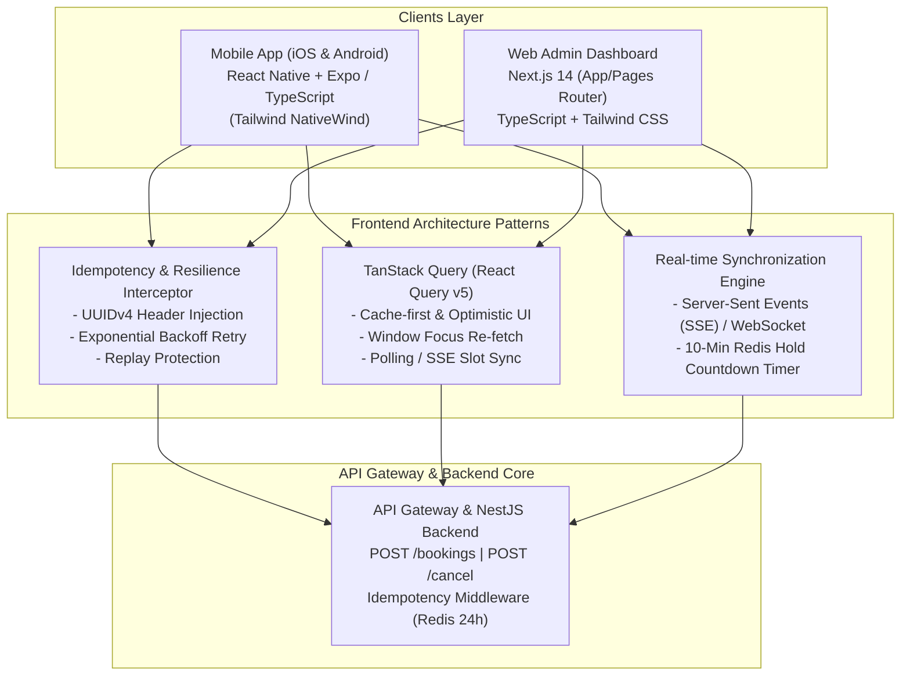

# Kiến Trúc Giao Diện Người Dùng (Frontend Architecture & Technology Stack)

**Dự án:** Smart Meeting Room Booking System  
**Phiên bản BRD:** v1.4 (Post-Audit Hardened)  
**Tác giả:** @Architect_Agent  
**Trạng thái:** Approved Architecture  
**Ngày phê duyệt:** 2026-10-06  

---

## 1. Chiến Lược Lựa Chọn Công Nghệ (Technology Stack Selection)

Để đáp ứng mục tiêu phát triển thần tốc, độ tin cậy cao trên đa nền tảng và tương thích tối ưu với hệ sinh thái Node.js/TypeScript hiện hữu của Backend, kiến trúc Frontend được chia thành hai phân hệ độc lập:



### 1.1. Phân hệ Mobile App: React Native (Expo) + TypeScript
* **Lý do lựa chọn:**
  * **Codebase thống nhất 95%:** Triển khai đồng thời trên cả iOS và Android chỉ với một codebase TypeScript, rút ngắn 50% thời gian so với phát triển Native riêng lẻ.
  * **Hỗ trợ Deep Link & Banking App SDK:** Tương thích tự nhiên với các URL scheme mở App ngân hàng/Ví điện tử (VNPAY Sandbox, MoMo SDK, ZaloPay) qua `expo-linking`.
  * **Hiệu năng & Trải nghiệm:** Sử dụng engine Hermes thế hệ mới, khởi động dưới 1.2s, thời gian phản hồi giao diện đạt 60 FPS mượt mà.
  * **Styling hiện đại:** Sử dụng `NativeWind` (Tailwind CSS cho React Native) giúp đồng bộ thiết kế Dark UI và Design System với bản Web Admin.

### 1.2. Phân hệ Web Admin: Next.js 14 + React + TypeScript + Tailwind CSS
* **Lý do lựa chọn:**
  * **Đã có sẵn nền tảng mã nguồn chất lượng cao:** Đã triển khai thành công [cash-booking.tsx](file:///home/nam/smart-booking-project/smart-booking-project/frontend/admin/pages/cash-booking.tsx) và [RefundModal.tsx](file:///home/nam/smart-booking-project/smart-booking-project/frontend/admin/components/RefundModal.tsx).
  * **SSR & Tối ưu hóa:** Next.js hỗ trợ kết xuất phía server (Server-Side Rendering) giúp tải nhanh bảng lịch Grid View hàng trăm slot phòng họp.
  * **Bảo mật phân quyền (RBAC):** Middleware phía Next.js chặn hoàn toàn các token không phải `STAFF` hoặc `ADMIN` trước khi chạm vào giao diện nhạy cảm.

---

## 2. Mô Hình Quản Lý Trạng Thái & Cơ Chế Optimistic UI (State & Optimistic Updates)

### 2.1. Quản lý Trạng thái với TanStack Query (React Query v5)
* Áp dụng mô hình **Server State Synchronization** thay vì Redux cồng kềnh:
  * **Query Keys có cấu trúc:** `['rooms', branchId, selectedDate]`, `['slots', roomId, date]`, `['booking', bookingId]`.
  * **Stale Time linh hoạt:** 15 giây cho danh sách slot phòng họp, 60 giây cho thông tin số dư ví thành viên.
  * **Background Refetching:** Tự động gọi lại API khi người dùng quay lại ứng dụng (`refetchOnWindowFocus: true`) nhằm phát hiện ngay các slot vừa bị người khác khóa.

### 2.2. Chiến lược Cập nhật Giao diện Lạc quan (Optimistic UI vs Pessimistic Safety)
* **Kịch bản Khóa phòng (Pessimistic Hold - An toàn tuyệt đối):**
  * *Nguyên tắc:* Tuyệt đối **KHÔNG** áp dụng Optimistic Update khi bấm "Đặt phòng". Vì việc khóa phòng phụ thuộc vào Redis Redlock phân tán, nếu frontend tự ý đổi trạng thái sang `LOCKED` trước khi API trả về 201 sẽ gây ảo giác cho người dùng khi bị 409 Conflict.
  * *Luồng chuẩn:* Frontend hiển thị trạng thái `isSubmitting = true` kèm loading spinner $\to$ Nhận HTTP 201 mới chuyển sang màn hình đếm ngược thanh toán.
* **Kịch bản Hủy phòng & Giải phóng Slot (Optimistic UI có Rollback):**
  * Khi bấm "Hủy phòng", frontend ngay lập tức:
    1. Cập nhật giao diện đơn phòng sang trạng thái `Đang hủy...`.
    2. Nếu API `/bookings/{id}/cancel` thành công $\to$ Cập nhật `CANCELLED` và refetch danh sách slot.
    3. Nếu API thất bại (ví dụ: `INVALID_OTP` trong Two-Man Rule) $\to$ Rollback trạng thái cũ và hiển thị thông báo lỗi tức thì.

---

## 3. Cơ Chế Xử Lý Idempotency-Key & Chống Gửi Đúp (Network Resilience)

Mọi HTTP request làm thay đổi trạng thái (POST, PUT, DELETE) gửi từ Frontend lên Backend bắt buộc phải tuân thủ chuẩn **Idempotency Interceptor**:

```typescript
// frontend/shared/api/httpClient.ts
import axios from 'axios';
import { v4 as uuidv4 } from 'uuid';

export const apiClient = axios.create({
    baseURL: process.env.NEXT_PUBLIC_API_URL || 'https://api.smartbooking.local/v1',
    timeout: 10000,
});

apiClient.interceptors.request.use((config) => {
    // Tự động gắn Idempotency-Key dạng UUIDv4 cho các request khởi tạo booking hoặc hủy
    if (config.method === 'post' && (config.url?.includes('/bookings') || config.url?.includes('/cancel'))) {
        if (!config.headers['Idempotency-Key']) {
            config.headers['Idempotency-Key'] = uuidv4();
        }
    }

    const token = localStorage.getItem('auth_token');
    if (token) {
        config.headers['Authorization'] = `Bearer ${token}`;
    }

    return config;
});
```

* **Xử lý Network Timeout / Retry:** Nếu request bị đứt mạng giữa chừng, client tự động retry với **chính xác cùng một Idempotency-Key**. Backend sẽ nhận ra key cũ trong Redis (TTL 24h) và trả về response đã lưu mà không trừ tiền ví lần thứ hai hay nhân đôi phiếu thu.

---

## 4. Xử Lý Các Trường Hợp Biên (Edge Cases Handling on UI)

### 4.1. Đồng hồ Đếm ngược Khóa phòng 10 Phút (10-Minute Lock TTL Countdown)
* **Vấn đề lệch giờ:** Giờ đồng hồ trên thiết bị người dùng (Client clock skew) có thể lệch 1-2 phút so với giờ máy chủ.
* **Giải pháp:**
  * Backend trả về `lock_expires_at` dạng ISO 8601 UTC timestamp và `server_time`.
  * Frontend tính toán độ lệch: $\delta = server\_time - client\_now$.
  * Đồng hồ đếm ngược được tính dựa trên: $remaining = lock\_expires\_at - (client\_now + \delta)$.
  * Khi đếm về 0: Khóa nút thanh toán, dừng Webhook polling, hiển thị modal thông báo hết hạn và đưa người dùng về danh sách phòng.

### 4.2. Xử lý Late Webhook & Saga Auto-Refund trên UI
* **Ngữ cảnh:** Khách hàng thanh toán sau phút thứ 10, ngân hàng đã trừ tiền nhưng phòng đã bị người khác đặt lại.
* **Phản hồi UI:**
  * Thay vì hiển thị lỗi chung chung "Đặt phòng thất bại", giao diện hiển thị Dialog trạng thái đặc biệt:
    ```text
    ┌────────────────────────────────────────────────────────┐
    │ ⚠️ THỜI GIAN GIỮ CHỖ ĐÃ HẾT HẠN                        │
    │ Giao dịch thanh toán VNPAY đã hoàn tất thành công      │
    │ nhưng phòng họp đã được giải phóng cho khách khác.     │
    │                                                        │
    │ Hệ thống đã tự động hoàn tiền 100% về tài khoản của    │
    │ bạn qua Saga Auto-Refund (Mã GD: VNP-REF-8891).       │
    └────────────────────────────────────────────────────────┘
    ```

### 4.3. Ràng buộc Two-Man Rule trên Web Admin
* Trên [RefundModal.tsx](file:///home/nam/smart-booking-project/smart-booking-project/frontend/admin/components/RefundModal.tsx), nút "Xác Nhận Hủy" bị khóa cứng (disabled) cho đến khi:
  1. Lý do hủy được điền đầy đủ.
  2. Trường OTP Quản lý ca trực được nhập đúng 6 ký tự số.
  3. Có bộ đếm ngược 60s cho nút "Gửi lại OTP" nhằm chống spam SMS OTP.

---

## 5. Tổ Chức Cấu Trúc Thư Mục Frontend Dự Kiến (Project Directory Layout)

```text
smart-booking-project/
├── frontend/
│   ├── admin/                         # Phân hệ Web Admin Dashboard (Next.js 14)
│   │   ├── components/
│   │   │   ├── CalendarGrid.tsx       # Lưới lịch đặt phòng tổng thể (Grid View)
│   │   │   ├── CorporateDebtModal.tsx # Form tạo đơn công nợ kèm kiểm tra credit_limit
│   │   │   ├── RefundModal.tsx        # [COMPLETED] Modal Two-Man Rule OTP
│   │   │   └── CashBookSummary.tsx    # Sổ quỹ ca trực & bàn giao quỹ
│   │   └── pages/
│   │       ├── index.tsx              # Dashboard & Master Calendar Grid View
│   │       ├── cash-booking.tsx       # [COMPLETED] Lễ tân đặt phòng thu tiền mặt
│   │       └── corporate-debts.tsx    # Quản lý danh sách & hạn mức công nợ
│   │
│   └── mobile/                        # Phân hệ Mobile App (React Native / Expo)
│       ├── src/
│       │   ├── screens/
│       │   │   ├── RoomSearchScreen.tsx    # Tra cứu & Lọc phòng thời gian thực
│       │   │   ├── RoomDetailScreen.tsx    # Chi tiết phòng & Khung giờ họp
│       │   │   ├── CheckoutScreen.tsx      # Thanh toán (Đồng hồ 10m, Ví, VNPAY)
│       │   │   ├── BookingHistoryScreen.tsx# Lịch sử đơn & Mã QR Check-in
│       │   │   └── CancelBookingScreen.tsx # Hủy phòng phân tầng & Bộ đếm tháng
│       │   ├── components/
│       │   │   ├── CountdownTimer.tsx      # Widget đếm ngược 600s chống lệch giờ
│       │   │   ├── QRCodeCard.tsx          # Thẻ mã QR check-in phòng họp
│       │   │   └── WalletBalanceCard.tsx   # Hiển thị số dư ví thành viên
│       │   └── services/
│       │       ├── api.ts                  # Axios client kèm Idempotency Interceptor
│       │       └── deepLinkHandler.ts      # Xử lý callback sau khi thanh toán VNPAY/MoMo
```
