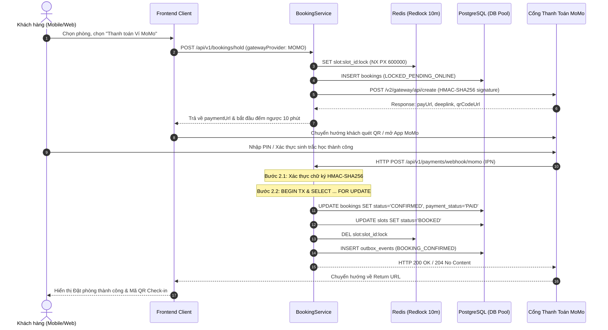
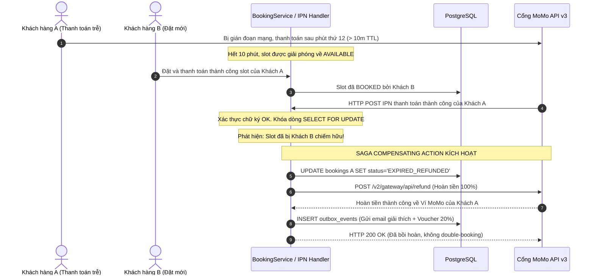

# 📘 KIẾN TRÚC TÍCH HỢP CỔNG THANH TOÁN MOMO (API v3)
## MoMo Payment Gateway v3 Architecture & Integration Blueprint

**Dự án:** Smart Meeting Room Booking System  
**Phiên bản:** v1.4 Hardened (MoMo API v3 Integration)  
**Tác giả:** Senior Backend Engineer (`@Dev_Agent`)  
**Ngày ban hành:** 2026-10-20  
**Trạng thái:** Production Ready  

---

## 📑 MỤC LỤC
1. [Tổng quan & Mục tiêu Kỹ thuật](#1-tổng-quan--mục-tiêu-kỹ-thuật)
2. [Thông số Xác thực & Quản trị Bí mật (.env)](#2-thông-số-xác-thực--quản-trị-bí-mật-env)
3. [Định tuyến 6 Phương thức Thanh toán (Payment Routing)](#3-định-tuyến-6-phương-thức-thanh-toán-payment-routing)
4. [Thuật toán Ký & Xác thực Dữ liệu (HMAC-SHA256)](#4-thuật-toán-ký--xác-thực-dữ-liệu-hmac-sha256)
5. [Quy trình Tích hợp 3 Module Bắt buộc](#5-quy-trình-tích-hợp-3-module-bắt-buộc)
   - [Module 1: Khởi tạo Thanh toán (Payment Initiation)](#module-1-khởi-tạo-thanh-toán-payment-initiation)
   - [Module 2: Xử lý IPN / Webhook & Saga Auto-Refund](#module-2-xử-lý-ipn--webhook--saga-auto-refund)
   - [Module 3: Fail-safe Timeout Worker & Query API](#module-3-fail-safe-timeout-worker--query-api)
6. [Sơ đồ Trình tự Nghiệp vụ (Mermaid Sequence Diagrams)](#6-sơ-đồ-trình-tự-nghiệp-vụ-mermaid-sequence-diagrams)
7. [Mã Nguồn & Vị trí Tệp Tích hợp](#7-mã-nguồn--vị-trí-tệp-tích-hợp)

---

## 1. Tổng quan & Mục tiêu Kỹ thuật

Hệ thống Đặt phòng họp thông minh tích hợp **Cổng thanh toán MoMo (API v3)** nhằm cung cấp giải pháp thanh toán không tiền mặt đa kênh, bảo mật và tức thì cho khách hàng vãng lai cũng như hội viên doanh nghiệp.

### Các nguyên tắc kỹ thuật cốt lõi:
1. **Tuân thủ Tuyệt đối BRD v1.4:** Thời hạn giữ chỗ trực tuyến là **10 phút (TTL 600s)** đồng bộ qua Redis Redlock.
2. **Khắc phục Thảm họa Late Webhook:** Nếu IPN từ MoMo gửi về sau thời hạn 10 phút và phòng đã bị người khác đặt, hệ thống kích hoạt **Saga Compensating Action (Auto-Refund 100%)** qua MoMo Refund API, triệt tiêu nguy cơ Double-booking.
3. **Idempotency & Concurrency:** Sử dụng `SELECT ... FOR UPDATE` trong Database Transaction và kiểm tra trạng thái trước khi xử lý, ngăn chặn ghi nhận trùng lặp giao dịch khi MoMo retry IPN.
4. **Không tin cậy Redirect URL:** Trạng thái đơn phòng chỉ được phép chốt tại Webhook IPN từ Server MoMo, tuyệt đối không dùng trang Return/Redirect của người dùng để cập nhật CSDL.

---

## 2. Thông số Xác thực & Quản trị Bí mật (.env)

Hệ thống sử dụng bộ 3 thông số định danh để giao tiếp với Cổng thanh toán MoMo:
* `partnerCode`: Mã định danh đối tác do MoMo cấp.
* `accessKey`: Khóa công khai dùng để định danh tài khoản gọi API.
* `secretKey`: Khóa bí mật dùng để sinh chữ ký số HMAC-SHA256.

> [!CAUTION]
> **QUY TẮC BẢO MẬT TỐI THƯỢNG:**  
> Tuyệt đối **KHÔNG BAO GIỜ** hardcode `secretKey` trong Frontend, Mobile App hoặc log ra console/logger. Toàn bộ thông số phải được nạp từ biến môi trường (`.env`).

### Cấu hình Môi trường (.env Template)
```ini
# ==============================================================================
# MOMO PAYMENT API v3 CREDENTIALS
# ==============================================================================
MOMO_ENV=sandbox # 'sandbox' hoặc 'production'
MOMO_PARTNER_CODE=MOMO_SMART_BOOKING
MOMO_ACCESS_KEY=MOMO_ACCESS_KEY_DEMO
MOMO_SECRET_KEY=MOMO_SECRET_KEY_DEMO_2026

# Endpoints
# Sandbox:    https://test-payment.momo.vn
# Production: https://payment.momo.vn
MOMO_ENDPOINT=https://test-payment.momo.vn

# URLs Callbacks
MOMO_REDIRECT_URL=https://smartbooking.vn/payment/momo/callback
MOMO_IPN_URL=https://api.smartbooking.vn/api/v1/payments/webhook/momo
```

---

## 3. Định tuyến 6 Phương thức Thanh toán (Payment Routing)

Tất cả các hình thức thanh toán MoMo đều sử dụng chung Endpoint khởi tạo đơn hàng:  
`POST /v2/gateway/api/create`

Hệ thống sử dụng **Factory Pattern / Strategy Pattern** ([`src/services/momo/strategies/`](file:///home/nam/smart-booking-project/smart-booking-project/src/services/momo/strategies)) để định tuyến logic theo tham số `requestType`:

| STT | Phương thức | Giá trị `requestType` | Kênh áp dụng | Ràng buộc nghiệp vụ & Dữ liệu yêu cầu |
|:---:|---|---|---|---|
| 1 | **Ví MoMo cơ bản** | `captureWallet` | Web / Mobile App | Quét mã QR hoặc Deep-link mở trực tiếp App MoMo. Mặc định `autoCapture: true`. |
| 2 | **Thẻ quốc tế (Visa/Mastercard/JCB)** | `payWithCC` | Web Admin / Mobile | Nhập thẻ quốc tế trực tiếp qua cổng MoMo. Số tiền tối thiểu 10,000 VND. |
| 3 | **Apple Pay** | `payWithApplePay` | iOS Safari / App | **Yêu cầu FE:** Kiểm tra `window.ApplePaySession.canMakePayments()`. **Bắt buộc:** Truyền `userInfo.email` hợp lệ. |
| 4 | **Google Pay** | `payWithGooglePay` | Android Chrome / App | Thanh toán 1 chạm qua thẻ liên kết trong Google Wallet. |
| 5 | **Thanh toán Định kỳ (Subscription)** | `subscription` | Hội viên thuê tháng | Bắt buộc đối tượng `subscriptionInfo` gồm: `frequency` ('MONTHLY'/'WEEKLY'), `recurringAmount`, `nextPaymentDate`. |
| 6 | **Tokenization (Lưu thẻ/ví)** | `payWithMethod` | Hội viên thân thiết | Giao dịch đầu nhận `callbackToken` từ IPN để đổi lấy token vĩnh viễn, các lần sau gọi kèm `token`. |

---

## 4. Thuật toán Ký & Xác thực Dữ liệu (HMAC-SHA256)

Áp dụng cho mọi Request gửi lên MoMo và Webhook IPN nhận về từ MoMo ([`MoMoSignatureUtil.ts`](file:///home/nam/smart-booking-project/smart-booking-project/src/services/momo/MoMoSignatureUtil.ts)):

### 4.1. Quy tắc Tạo Chữ ký (Request Outgoing)
1. Gom tất cả tham số bắt buộc theo API của MoMo (loại bỏ giá trị `null`, `undefined` hoặc `signature`).
2. Sắp xếp các tham số theo **thứ tự từ điển (A-Z)** dựa trên tên biến (key).
3. Nối thành chuỗi dạng `key1=value1&key2=value2...`.
4. Mã hóa chuỗi trên bằng thuật toán **HMAC_SHA256** với khóa bí mật `secretKey`.
5. Kết quả (Signature) là chuỗi **Hexadecimal viết thường** (64 ký tự).

### 4.2. Quy tắc Xác thực IPN (Incoming Webhook)
1. Bóc tách chữ ký `receivedSignature = body.signature`.
2. Lấy toàn bộ trường trong body (loại trừ trường `signature`), bổ sung `accessKey`.
3. Tính toán chữ ký HMAC-SHA256 chuẩn hóa.
4. So sánh hai chữ ký bằng **`crypto.timingSafeEqual`** để chống tấn công Timing Attack.
5. Nếu chữ ký không khớp $\rightarrow$ Trả về ngay **`HTTP 400 Bad Request`**, không truy vấn Database.

---

## 5. Quy trình Tích hợp 3 Module Bắt buộc

### Module 1: Khởi tạo Thanh toán (Payment Initiation)
* **Tệp:** [`src/services/momo/MoMoPaymentService.ts`](file:///home/nam/smart-booking-project/smart-booking-project/src/services/momo/MoMoPaymentService.ts) -> `createPayment()`
* **Quy trình:**
  1. Tạo mã đặt phòng duy nhất `bookingCode` (VD: `BKG-202610-12345`) và lưu CSDL với trạng thái `LOCKED_PENDING_ONLINE`.
  2. Khóa giữ slot phòng trên Redis Redlock với TTL 10 phút (600,000 ms).
  3. Đóng gói `extraData` dạng Base64 JSON chứa `{ userId, bookingId, slotId }`.
  4. Lấy Strategy từ `MoMoPaymentStrategyFactory` để kiểm tra và hoàn thiện payload.
  5. Tính toán chữ ký số HMAC-SHA256.
  6. Gửi HTTP POST tới `/v2/gateway/api/create`.
  7. Trả về `payUrl`, `deeplink`, `qrCodeUrl` cho Frontend/Mobile Client chuyển hướng người dùng.

### Module 2: Xử lý IPN / Webhook & Saga Auto-Refund (QUAN TRỌNG NHẤT)
* **Tệp:** [`src/services/momo/MoMoPaymentService.ts`](file:///home/nam/smart-booking-project/smart-booking-project/src/services/momo/MoMoPaymentService.ts) -> `processIpn()`
* **Quy trình:**
  * **Bước 2.1 (Xác thực):** Kiểm tra chữ ký HMAC-SHA256. Nếu sai lệch $\rightarrow$ Trả về `HTTP 400`. Ghi log: `[MoMo IPN] Received orderId: ..., resultCode: ...`.
  * **Bước 2.2 (Chống trùng lặp - Idempotency):** Khởi tạo Transaction với `SELECT ... FOR UPDATE`. Nếu đơn đã ở trạng thái `CONFIRMED` và `PAID` $\rightarrow$ Trả về `HTTP 204 No Content` và dừng xử lý.
  * **Bước 2.3 (Cập nhật & Saga Compensation):**
    * **Nhánh Thất bại (`resultCode !== 0`):** Giải phóng Redis lock, mở lại slot về `AVAILABLE`, cập nhật đơn `CANCELLED_NO_REFUND`.
    * **Nhánh Thành công (`resultCode === 0`):**
      * Kiểm tra xem slot có bị ai chiếm mất do quá hạn 10 phút không.
      * *Nếu gặp thảm họa Late Webhook:* Kích hoạt **Saga Auto-Refund 100%** qua MoMo Refund API (`POST /v2/gateway/api/refund`), cập nhật đơn `EXPIRED_REFUNDED`, đẩy outbox event bồi thường kèm voucher 20%. Không bao giờ ghi đè đơn phòng của khách mới!
      * *Nếu slot hợp lệ trong 10 phút (Happy Path):* Cập nhật đơn sang `CONFIRMED` và `PAID`, cập nhật slot sang `BOOKED`, giải phóng Redis lock, đẩy outbox event `BOOKING_CONFIRMED` (phát hành mã QR check-in).

### Module 3: Fail-safe Timeout Worker & Query API
* **Tệp:** [`src/services/momo/MoMoTimeoutWorker.ts`](file:///home/nam/smart-booking-project/smart-booking-project/src/services/momo/MoMoTimeoutWorker.ts)
* **Quy trình:**
  1. Chạy ngầm định kỳ (mỗi 5–10 phút).
  2. Quét các đơn `LOCKED_PENDING_ONLINE` mà `lock_expires_at < NOW()`.
  3. Gửi truy vấn trạng thái thực tế sang MoMo qua Query API: `POST /v2/gateway/api/query`.
  4. Nếu MoMo báo chưa thanh toán/thất bại: Đánh dấu đơn `EXPIRED`, giải phóng slot về `AVAILABLE` và xóa Redis lock.
  5. Nếu MoMo báo đã thanh toán thành công (nhưng rớt mạng IPN): Tự động đồng bộ sang luồng `processIpn` để chốt đơn phòng hoặc hoàn tiền.

---

## 6. Sơ đồ Trình tự Nghiệp vụ (Mermaid Sequence Diagrams)

### 6.1. Luồng Chuẩn (Happy Path - Thanh toán Thành công trong 10 phút)


### 6.2. Luồng Phòng Vệ (Late Webhook Saga Auto-Refund)


---

## 7. Mã Nguồn & Vị trí Tệp Tích hợp

| Tệp Mã Nguồn | Chức Năng Chính | Trạng Thái |
|---|---|:---:|
| [`src/services/momo/types.ts`](file:///home/nam/smart-booking-project/smart-booking-project/src/services/momo/types.ts) | Định nghĩa Enums, Request/Response payloads, Config, ExtraData | **Hoàn thành** |
| [`src/services/momo/MoMoSignatureUtil.ts`](file:///home/nam/smart-booking-project/smart-booking-project/src/services/momo/MoMoSignatureUtil.ts) | Ký HMAC-SHA256 A-Z, Xác thực chữ ký số bằng `timingSafeEqual` | **Hoàn thành** |
| [`src/services/momo/strategies/index.ts`](file:///home/nam/smart-booking-project/smart-booking-project/src/services/momo/strategies/index.ts) | Triển khai Strategy & Factory Pattern cho 6 hình thức thanh toán | **Hoàn thành** |
| [`src/services/momo/MoMoPaymentService.ts`](file:///home/nam/smart-booking-project/smart-booking-project/src/services/momo/MoMoPaymentService.ts) | Module 1 (Khởi tạo), Module 2 (IPN Handler & Saga), Hoàn tiền | **Hoàn thành** |
| [`src/services/momo/MoMoTimeoutWorker.ts`](file:///home/nam/smart-booking-project/smart-booking-project/src/services/momo/MoMoTimeoutWorker.ts) | Module 3: Fail-safe Cronjob đối soát đơn quá hạn qua Query API | **Hoàn thành** |
| [`src/services/PaymentWebhookService.ts`](file:///home/nam/smart-booking-project/smart-booking-project/src/services/PaymentWebhookService.ts) | Tích hợp định tuyến IPN MoMo song song với VNPAY | **Hoàn thành** |
| [`src/services/BookingService.ts`](file:///home/nam/smart-booking-project/smart-booking-project/src/services/BookingService.ts) | Tích hợp khởi tạo link thanh toán MoMo khi đặt phòng | **Hoàn thành** |
| [`test/services/momo_payment.test.ts`](file:///home/nam/smart-booking-project/smart-booking-project/test/services/momo_payment.test.ts) | Bộ kiểm thử toàn diện chữ ký, factory, IPN, idempotency, timeout | **Hoàn thành** |
