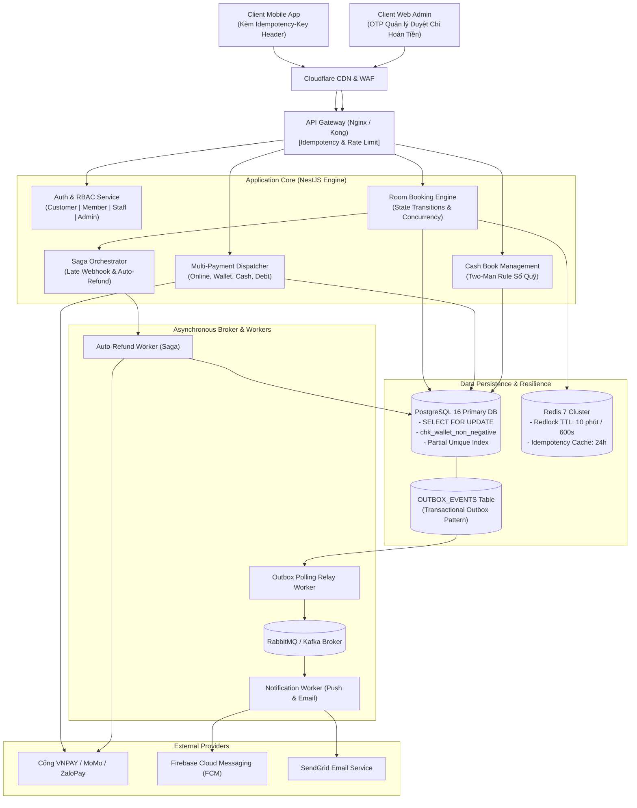

# System Design & Architecture Document
**Project:** Smart Meeting Room Booking System  
**BRD Version Alignment:** v1.4 (Post-Audit Hardened)  
**Status:** Approved Architecture  
**Last Updated:** 2026-10-05  

---

## 1. Tổng quan Kiến trúc Hệ thống (Target Architecture v1.4)
Hệ thống **Smart Meeting Room Booking System** được thiết kế theo mô hình **Modular Monolith kết hợp Event-Driven Resilience**, khắc phục toàn bộ các lỗ hổng về Race Condition, Late Webhooks và thất lạc tin nhắn thông báo được chỉ ra trong báo cáo thẩm định [design_evaluation_report.md](../03-project-management/design_evaluation_report.md).



---

## 2. Các Thành phần Hệ thống & Cơ Chế Khắc Phục Lỗ Hổng

### 2.1. API Gateway & Middleware Kiểm soát Trùng lặp (Idempotency)
- **Header `Idempotency-Key`:** Bắt buộc áp dụng cho toàn bộ các endpoint ghi dữ liệu (`POST /api/v1/bookings`).
- **Cơ chế:** Lưu cặp key-value `idempotency:{key} -> {response_data}` vào Redis với TTL 24 giờ. Nếu client gửi lại cùng 1 key trong 24h (do bấm đúp nút thanh toán hoặc thử lại khi mạng lag), hệ thống trả về kết quả đã lưu trước đó mà không thực hiện trừ tiền hay tạo đơn phòng mới.

### 2.2. Distributed Lock & Concurrency (Redis Redlock - TTL 10 phút)
- **Thời gian giữ chỗ Online:** Được nâng từ 5 phút lên **10 phút (600.000 ms)**:
  ```text
  SET slot:{slot_id}:lock {user_id} NX PX 600000
  ```
  Đảm bảo người dùng có đủ thời gian chuyển app ngân hàng, đăng nhập sinh trắc học và nhập mã SMS/Smart OTP.
- **Giải phóng khóa an toàn bằng Lua Script (Safe Lock Release):** Chỉ chủ sở hữu token giữ lock mới có quyền xóa key, tránh trường hợp request chậm xóa nhầm lock của request khác:
  ```lua
  if redis.call("get", KEYS[1]) == ARGV[1] then
      return redis.call("del", KEYS[1])
  else
      return 0
  end
  ```

### 2.3. Saga Orchestration & Xử lý "Late Webhook" (Auto-Refund)
Khi nhận Webhook/IPN báo trừ tiền thành công từ VNPAY/MoMo:
1. **Kiểm tra trạng thái Slot:** Hệ thống kiểm tra xem Slot tương ứng còn thuộc về `booking_id` của khách hàng này không.
2. **Kịch bản Happy Path (IPN đến trong 10 phút):** Cập nhật `booking_status = CONFIRMED`, `payment_status = PAID`.
3. **Kịch bản Late Webhook (IPN đến sau 10 phút, Slot đã bị người khác đặt):**
   - **Tuyệt đối không đè trạng thái sang CONFIRMED.**
   - Saga Orchestrator kích hoạt Compensating Transaction: Đẩy job vào `RefundWorker`.
   - `RefundWorker` gọi API hoàn tiền tự động 100% (`POST /vnpay/refund`) trả lại tiền cho khách hàng.
   - Ghi nhận `AUDIT_LOGS` và gửi thông báo xin lỗi qua SMS/Email.

### 2.4. Transactional Outbox Pattern (Đảm bảo 100% không thất lạc thông báo & mã QR)
- Loại bỏ hoàn toàn rủi ro mất mát message khi ứng dụng bị crash giữa lúc commit Database và publish sang RabbitMQ:
  - Khi tạo booking hoặc trừ ví thành công, một bản ghi event được chèn đồng thời vào bảng `OUTBOX_EVENTS` trong cùng một database transaction.
  - `Outbox Relay Worker` chạy background định kỳ (polling mỗi 500ms) quét các bản ghi `status = PENDING` trong `OUTBOX_EVENTS`, gửi vào RabbitMQ và cập nhật `status = PROCESSED`.
  - Đảm bảo tính nhất quán cuối cùng (**Eventual Consistency**) với cam kết **At-least-once Delivery**.

### 2.5. Bảo vệ An toàn Số dư Ví Thành viên (Pessimistic Lock & DB Constraint)
- Ngăn chặn triệt để tấn công **Double-Spending**:
  ```sql
  BEGIN;
  -- Khóa dòng dữ liệu ví của user, chặn mọi transaction khác đọc ghi đồng thời
  SELECT balance FROM member_wallets WHERE user_id = $1 FOR UPDATE;
  
  -- Kiểm tra số dư và trừ tiền
  UPDATE member_wallets SET balance = balance - $2 WHERE user_id = $1;
  INSERT INTO wallet_transactions (...);
  INSERT INTO bookings (...);
  INSERT INTO outbox_events (...);
  COMMIT;
  ```
- Thêm ràng buộc CSDL: `ALTER TABLE member_wallets ADD CONSTRAINT chk_wallet_non_negative CHECK (balance >= 0);`

### 2.6. Quy trình Hoàn tiền mặt 2 bước (Two-Man Rule) & Hạn mức Công nợ (Credit Limit)
- **Hạn mức công nợ:** Bảng `USERS` / `COMPANIES` có 2 trường `credit_limit` và `current_debt`. Mọi booking công nợ đều phải thỏa mãn:
  $$current\_debt + room\_price \le credit\_limit$$
  Nếu vượt hạn mức, hệ thống trả về mã lỗi HTTP 422 `CREDIT_LIMIT_EXCEEDED`.

- **Quy trình Two-Man Rule Sổ Quỹ (Kiểm soát gian lận tiền mặt):**
  Lễ tân không thể đơn phương xuất quỹ hoàn tiền mặt. Mọi giao dịch hoàn tiền mặt có giá trị $> 0$ bắt buộc phải được Quản lý ca trực (Shift Supervisor) phê duyệt qua mã OTP.

```mermaid
sequenceDiagram
    autonumber
    actor Receptionist as Lễ Tân (Web Admin)
    actor Supervisor as Quản Lý Ca Trực (Supervisor)
    participant Gateway as API Gateway
    participant BookingSvc as Booking Engine
    participant CashBook as Cash Book Module
    participant DB as PostgreSQL 16 (ACID Tx)
    participant Redis as Redis Cache

    Receptionist->>Gateway: POST /bookings/{id}/request-refund-otp
    Gateway->>BookingSvc: Sinh OTP 6 số ngẫu nhiên (TTL 60s)
    BookingSvc->>Redis: SET otp:refund:{id} 888999 EX 60
    BookingSvc-->>Supervisor: SMS / Push OTP thông báo yêu cầu duyệt chi
    Receptionist->>Gateway: POST /bookings/{id}/cancel { reason, supervisor_otp: "888999" }
    Gateway->>BookingSvc: cancelBooking(id, user, reason, otp)
    
    rect rgb(30, 41, 59)
        note over BookingSvc,DB: Bắt đầu Transaction (SELECT ... FOR UPDATE)
        BookingSvc->>DB: Khóa dòng booking b.id FOR UPDATE
        BookingSvc->>Redis: GET otp:refund:{id} & Đối chiếu mã
        alt OTP không hợp lệ hoặc thiếu
            BookingSvc-->>Gateway: Lỗi HTTP 400 OTP_REQUIRED / INVALID_OTP
            Gateway-->>Receptionist: Hiển thị cảnh báo lỗi Two-Man Rule
        else OTP hợp lệ
            BookingSvc->>BookingSvc: Tính tỷ lệ hoàn phân tầng (100% / 80% / 0%)
            BookingSvc->>DB: INSERT INTO cash_book_logs (entry_type='CASH_OUT_REFUND', amount, ...)
            BookingSvc->>DB: UPDATE bookings SET booking_status='CANCELLED', refund_amount=...
            BookingSvc->>DB: UPDATE slots SET status='AVAILABLE', lock_expires_at=NULL
            BookingSvc->>DB: INSERT INTO outbox_events (event_type='BOOKING_CANCELLED', ...)
            BookingSvc->>DB: COMMIT Transaction
            BookingSvc-->>Gateway: HTTP 200 { refund_amount, cash_book_entry_id, status: CANCELLED }
            Gateway-->>Receptionist: Hiển thị biên nhận phiếu chi hoàn tiền mặt
        end
    end
```



---

## 3. Chiến lược Lưu trữ & Chỉ mục CSDL (PostgreSQL 16)
- **Partial Unique Index chống trùng lịch:**
  ```sql
  CREATE UNIQUE INDEX idx_unique_active_meeting_slot 
  ON bookings (slot_id) 
  WHERE booking_status NOT IN ('CANCELLED', 'CANCELLED_NO_REFUND', 'EXPIRED');
  ```
- **Outbox Index cho Relay Worker:**
  ```sql
  CREATE INDEX idx_outbox_pending 
  ON outbox_events (created_at) 
  WHERE status = 'PENDING';
  ```
