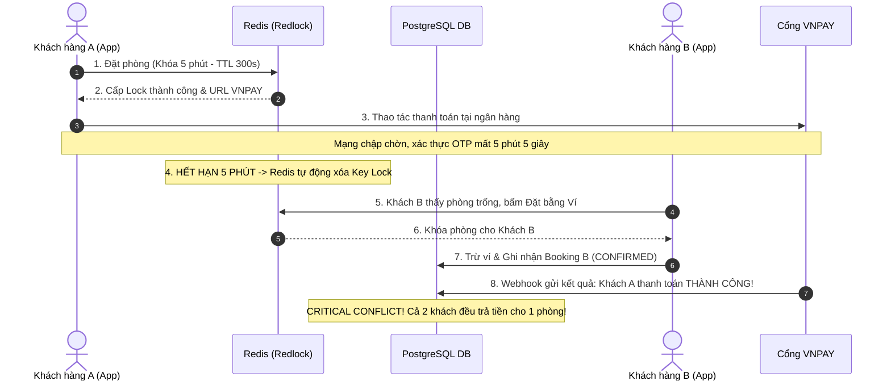
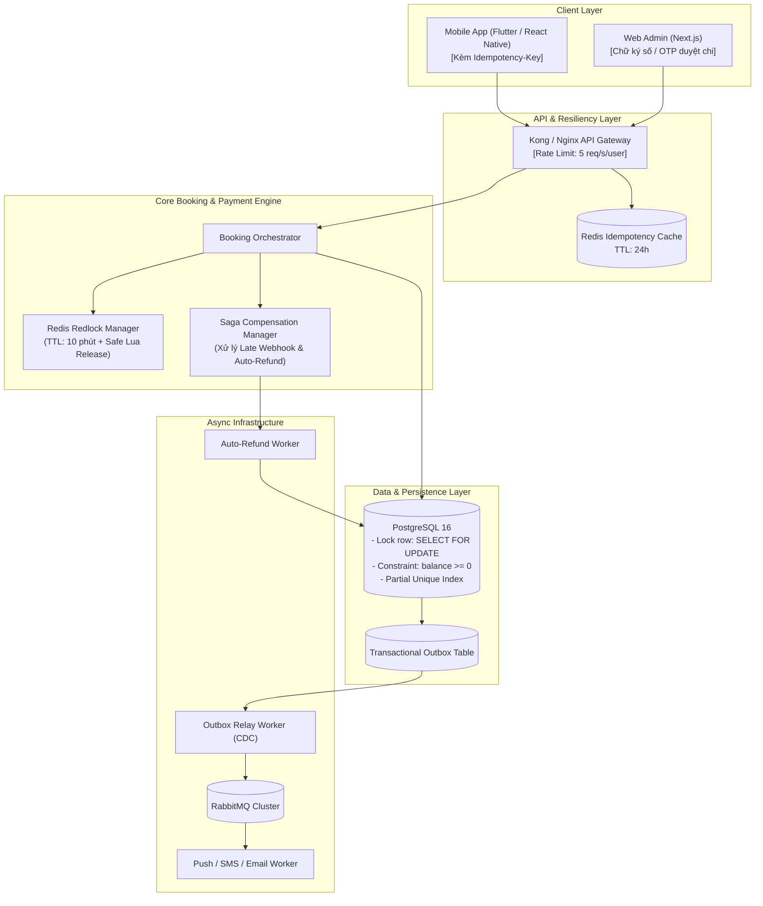

# BÁO CÁO ĐÁNH GIÁ KIẾN TRÚC & PHÂN TÍCH LỖ HỔNG HỆ THỐNG
## System Audit, Edge Case & Architecture Gap Analysis Report
**Dự án:** Smart Meeting Room Booking System  
**Phiên bản đánh giá:** BRD v1.3 & Architecture v1.3  
**Hội đồng thẩm định:** Cross-Functional Agent Crew (@BA_Agent, @Architect_Agent, @PM_Agent)  
**Ngày lập báo cáo:** 2026-10-05  
**Trạng thái quyết định:** CONDITIONAL GO (Phê duyệt có điều kiện bổ sung)  

---

## 1. TỔNG QUAN ĐIỀU HÀNH (EXECUTIVE SUMMARY)

Báo cáo này là kết quả kiểm thử tư duy phản biện (Devil's Advocate Audit) độc lập giữa Bộ phận Nghiệp vụ (@BA_Agent) và Bộ phận Kiến trúc Hệ thống (@Architect_Agent) đối với toàn bộ tài liệu yêu cầu nghiệp vụ [brd_v1.3.md](file:///home/nam/smart-booking-project/smart-booking-project/01-requirements/brd_v1.3.md), hệ thống User Stories, ERD Cơ sở dữ liệu [database_erd.md](file:///home/nam/smart-booking-project/smart-booking-project/02-architecture/database_erd.md), tài liệu [system_design.md](file:///home/nam/smart-booking-project/smart-booking-project/02-architecture/system_design.md) và hợp đồng API [booking_api.yaml](file:///home/nam/smart-booking-project/smart-booking-project/02-architecture/api_contracts/booking_api.yaml).

### Bảng Đánh Giá Năng Lực Hệ Thống (Audit Scorecard)
| Tiêu chí thẩm định | Điểm | Đánh giá tổng quan |
|---|:---:|---|
| **Tính hoàn thiện nghiệp vụ (Business Completeness)** | **B-** | Các luồng chính rõ ràng nhưng thiếu cơ chế bảo vệ thất thoát tiền mặt, phạt quá giờ (overstay) và lỗ hổng chính sách hủy phòng. |
| **Kiến trúc & Khả năng mở rộng (Scalability)** | **B+** | Phân tách modular tốt, có tích hợp Redis Redlock và RabbitMQ. Tuy nhiên cơ chế đồng bộ giữa In-memory và RDBMS còn điểm nghẽn. |
| **Tính toàn vẹn dữ liệu & Concurrency** | **B** | Đã có Partial Unique Index ở Postgres. Tuy nhiên tồn tại nguy cơ race condition nghiêm trọng ở luồng "Late Webhook" và "Double-Spending" Ví thành viên. |
| **An toàn & Kiểm soát rủi ro (Risk & Security)** | **C+** | Chưa có Idempotency-Key, thiếu chữ ký số/OTP khi hoàn tiền mặt tại quầy, chưa có trần công nợ nội bộ. |

> [!WARNING]
> **CẢNH BÁO QUAN TRỌNG TỪ HỘI ĐỒNG THẨM ĐỊNH:**  
> Hệ thống hiện tại có thể vận hành ổn định trong điều kiện lý tưởng (Happy Path). Tuy nhiên, khi đối mặt với **lượng truy cập đột biến (Traffic Spike lúc 8:00 sáng)**, **người dùng có hành vi gian lận (Malicious Actors)** hoặc **độ trễ mạng từ phía Cổng thanh toán bên thứ ba**, hệ thống sẽ gặp phải 2 thảm họa kỹ thuật nghiêm trọng:
> 1. **Khách hàng bị trừ tiền ngân hàng nhưng phòng bị người khác cướp mất** (Kịch bản Late Webhook quá 5 phút).
> 2. **Tấn công găm giữ toàn bộ phòng họp đắc địa không mất tiền** (Kịch bản lách luật hủy trước 2 giờ 01 phút).

---

## 2. PHÂN TÍCH RỦI RO NGHIỆP VỤ & LỖ HỔNG LOGIC (@BA_Agent)

### 2.1. Lỗ Hổng 1: Bẫy Trải Nghiệm Khách Hàng - Thời Hạn Giữ Chỗ Online 5 Phút (TTL 300s)
*   **Vấn đề thực tế:**  
    Tại Việt Nam, quy trình thanh toán qua VNPAY / MoMo / ZaloPay đối với người dùng di động bao gồm 5 bước:  
    1. Nhấn đặt phòng $\to$ 2. Điều hướng App-to-App sang Ứng dụng Ngân hàng $\to$ 3. Đăng nhập Sinh trắc học $\to$ 4. Chờ nhận mã OTP qua SMS / Smart OTP $\to$ 5. Xác nhận trừ tiền.  
    Vào các khung giờ cao điểm viễn thông (9:00 - 11:30 sáng), tin nhắn SMS OTP của các nhà mạng viễn thông thường xuyên bị nghẽn từ 2 đến 4 phút.
*   **Hậu quả:**  
    Nếu khách hàng mất 5 phút 10 giây để hoàn thành OTP, tiền trong tài khoản ngân hàng đã bị trừ, nhưng hệ thống backend đã kích hoạt Redis Key Expiration (hết 300s) và mở lại phòng cho khách khác. Khách hàng nhận được tin nhắn trừ tiền nhưng ứng dụng báo: *"Đã hết hạn giữ phòng, đặt phòng thất bại"*. Đây là nguyên nhân hàng đầu gây ra khủng hoảng khiếu nại (Customer Dispute).
*   **Giải pháp đề xuất:**
    *   Nâng thời gian chờ thanh toán cơ bản lên **10 phút** (phù hợp với tiêu chuẩn đặt vé máy bay, rạp chiếu phim, khách sạn).
    *   Triển khai **Dynamic Lock Extension (Gia hạn thời gian khóa động):** Nếu ứng dụng Mobile App phát hiện khách hàng đã chuyển sang màn hình cổng thanh toán thành công, client gửi tín hiệu Ping (Heartbeat) để xin gia hạn thêm tối đa 3 phút.

### 2.2. Lỗ Hổng 2: Tấn Công Găm Phòng Không Mất Phí (Inventory Denial-of-Service via 2h01m Loophole)
*   **Vấn đề thực tế:**  
    Theo BRD v1.3 Mục 5.5: Khách tự hủy trước $\ge 2$ giờ được hoàn tiền 100%.  
    Một đối thủ cạnh tranh hoặc một người dùng ác ý có thể viết script đặt trước toàn bộ các phòng họp VIP từ sáng sớm cho các khung giờ đẹp (ví dụ 14:00 - 17:00). Đến đúng **11:59 sáng** (cách giờ họp 2 giờ 01 phút), script tự động bấm Hủy toàn bộ đơn đặt phòng.
*   **Hậu quả:**  
    *   Kẻ phá hoại được hoàn trả **100% tiền cọc/số dư ví**, không chịu bất kỳ chế tài tài chính nào.
    *   Doanh nghiệp mất sạch khách hàng tiềm năng trong suốt cả buổi sáng vì hệ thống luôn báo "Hết phòng".
    *   Khi phòng được mở khóa lúc 11:59, với thời gian chỉ còn 2 tiếng, xác suất tìm được khách thuê phòng họp đột xuất gần như bằng 0.
*   **Giải pháp đề xuất:**
    *   **Áp dụng Chính sách Hủy Đa Tầng (Multi-tiered Cancellation Policy):**
        *   Hủy trước $\ge 24$ giờ: Hoàn 100%.
        *   Hủy từ 2 giờ đến dưới 24 giờ: Phạt 20% - 30% phí giữ phòng (chỉ hoàn 70% - 80%).
        *   Hủy dưới 2 giờ: Không hoàn tiền (0%).
    *   **Giới hạn Tần suất Hủy (Cancellation Rate Limiting):** Mỗi tài khoản chỉ được phép hủy phòng miễn phí tối đa 2 lần/tháng. Lần thứ 3 trở đi áp dụng phí cố định.
    *   **Chuyển đổi phí hoàn tiền cổng thanh toán:** Quy định rõ khách hàng chịu phí xử lý giao dịch cổng thanh toán (Payment Gateway Gateway Fee ~ 1.5% - 2%) khi hủy phòng chủ động.

### 2.3. Lỗ Hổng 3: Thất Thoát Tài Chính Tại Quầy (Walk-in Cash) & Không Có Tiền Cọc Thế Chân
*   **Vấn đề thực tế:**
    1.  *Thiếu tiền đặt cọc thiết bị & phạt quá giờ (Overstay & Damage Deposit):* Khách vãng lai thuê phòng bằng tiền mặt, sau cuộc họp làm vỡ màn hình TV/bảng kính hoặc sử dụng lố giờ 60 phút rồi bỏ về. Do không có thẻ tín dụng giữ chỗ hoặc cọc thiết bị, tòa nhà không thể truy thu bồi thường.
    2.  *Lỗ hổng gian lận hoàn tiền mặt của Lễ tân (Fake Cash Refund):* Lễ tân có thể thông đồng: Tạo đơn khách tiền mặt `CONFIRMED_PAID`, sau khi khách họp xong và về, lễ tân bấm "Hủy & Hoàn tiền mặt" và bỏ túi riêng số tiền mặt đã thu.
*   **Giải pháp đề xuất:**
    *   Quy định biểu phí phạt quá giờ tự động (Overstay Surcharge): Tính 150% đơn giá theo block 15 phút.
    *   Quy trình Hoàn tiền mặt 2 bước (Two-Man Rule): Khi Admin bấm hoàn tiền mặt trên Web Admin, hệ thống phải gửi mã OTP xác nhận về số điện thoại của Quản lý ca trực (Shift Supervisor) hoặc gửi mã OTP về số điện thoại của Khách hàng để ký nhận điện tử trước khi sổ quỹ ghi nhận phiếu chi.

### 2.4. Lỗ Hổng 4: Rủi Ro Công Nợ Vô Hạn (Uncapped Postpaid Debt)
*   **Vấn đề thực tế:**  
    Hiện tại API và BRD cho phép lễ tân chọn `POSTPAID_DEBT` mà không kiểm tra hạn mức công nợ (`credit_limit`) của doanh nghiệp hay phòng ban đó.
*   **Giải pháp đề xuất:**  
    Thêm trường `credit_limit` và `current_debt` vào bảng khách hàng doanh nghiệp. Nếu `current_debt + booking_amount > credit_limit`, hệ thống tự động khóa tính năng đặt nợ và yêu cầu chuyển sang thanh toán trả trước.

---

## 3. ĐIỂM NGHẼN KỸ THUẬT, CONCURRENCY & BẢO MẬT (@Architect_Agent)

### 3.1. Thảm Họa Kỹ Thuật Số 1: "Late Webhook" Dẫn Đến Xung Đột Đặt Trùng Phòng (Double-Booking)
Đây là rủi ro kiến trúc nghiêm trọng nhất trong hệ thống hiện tại.



*   **Nguyên nhân gốc rễ:**  
    Thiết kế hiện tại xem việc hết hạn Redis Lock đồng nghĩa với việc giao dịch phía ngân hàng đã thất bại. Thực tế, trạng thái trừ tiền tại ngân hàng và trạng thái TTL trên server là hai hệ thống phân tán không đồng bộ (Asynchronous Distributed Systems).
*   **Giải pháp kiến trúc:**
    1.  **Cơ chế Webhook Đối soát & Hoàn tiền tự động (Auto-Reversal / Compensating Action):**  
        Khi Webhook thanh toán thành công gửi về:
        - Hệ thống kiểm tra xem Slot tương ứng còn thuộc về `booking_id` của Khách A không.
        - Nếu Slot đã bị chiếm bởi Khách B (do timeout): Hệ thống **KHÔNG ĐƯỢC** đè trạng thái sang `CONFIRMED`.
        - Lập tức kích hoạt lệnh API hoàn tiền tự động (`REFUND_REQUEST`) trả lại 100% tiền về tài khoản ngân hàng của Khách A, đồng thời gửi thông báo xin lỗi kèm mã giảm giá voucher đền bù.
    2.  **Grace Period Buffer (Thời gian đệm đối soát):**  
        Khi hết 5 phút TTL, hệ thống chuyển sang trạng thái chờ đối soát `AWAITING_SETTLEMENT` trong 60 giây. Trong 60 giây này, chủ động gọi Query API sang VNPAY/MoMo để kiểm tra trạng thái cuối cùng trước khi chính thức mở phòng cho Khách B.

### 3.2. Nguy Cơ Race Condition & Tấn Công Tiêu Âm Tiền Ví (Double-Spending Attack)
*   **Lỗ hổng trong mã nguồn dự kiến:**  
    Nếu API trừ tiền ví thành viên triển khai theo mô hình đọc rồi ghi thông thường:
    ```typescript
    // MÃ NGUỒN NGUY HIỂM:
    const wallet = await walletRepo.findByUserId(userId);
    if (wallet.balance >= roomPrice) {
        await walletRepo.update(wallet.id, { balance: wallet.balance - roomPrice });
        await bookingRepo.create({ status: 'CONFIRMED' });
    }
    ```
    Nếu một thành viên mở 2 thiết bị di động hoặc chạy script gửi 2 request song song trong vòng 5 mili-giây với số dư 400.000 VND để đặt 2 phòng (mỗi phòng 350.000 VND): Cả hai luồng xử lý đều đọc được số dư là 400.000 VND và cùng thực hiện trừ tiền $\to$ Ví bị âm tiền hoặc gian lận đặt được 700.000 VND tiền phòng với chỉ 400.000 VND!
*   **Giải pháp kiến trúc bắt buộc:**
    *   **Khóa dòng dữ liệu mức CSDL (Pessimistic Locking):**
        ```sql
        BEGIN;
        SELECT balance FROM member_wallets WHERE user_id = $1 FOR UPDATE;
        -- Kiểm tra số dư tại đây
        UPDATE member_wallets SET balance = balance - $2 WHERE user_id = $1;
        INSERT INTO wallet_transactions (...);
        INSERT INTO bookings (...);
        COMMIT;
        ```
    *   **Ràng buộc Database Check Constraint:**
        ```sql
        ALTER TABLE member_wallets ADD CONSTRAINT chk_wallet_non_negative CHECK (balance >= 0);
        ```
    *   **Bắt buộc sử dụng Header `Idempotency-Key`:** Bất kỳ request đặt phòng hoặc trừ tiền ví nào cũng phải kèm theo UUID duy nhất từ client để loại bỏ trùng lặp request khi bấm đúp nút thanh toán.

### 3.3. Rủi Ro Thất Lạc Sự Kiện Khi Sử Dụng Message Queue (RabbitMQ / Kafka)
*   **Vấn đề:**  
    Trong file `system_design.md`, sau khi thanh toán thành công, hệ thống ghi DB và publish event sang RabbitMQ để Notification Worker gửi email/mã QR.  
    Nếu Database commit thành công nhưng tiến trình ứng dụng bị sập (Crash / OOM / Network Glitch) ngay trước khi gửi message vào RabbitMQ, khách hàng sẽ vĩnh viễn không nhận được mã QR vào phòng!
*   **Giải pháp kiến trúc:**  
    Triển khai **Transactional Outbox Pattern**:
    - Bảng `OUTBOX_EVENTS` được lưu trong cùng transaction CSDL với bảng `BOOKINGS`.
    - Một background worker (Debezium CDC hoặc Polling Publisher) đọc các event chưa gửi trong bảng `OUTBOX_EVENTS` đẩy vào RabbitMQ với cơ chế `At-least-once Delivery`.

---

## 4. ĐỀ XUẤT KIẾN TRÚC MỤC TIÊU & GIẢI PHÁP THAY THẾ (TARGET ARCHITECTURE)



### Các Cải Tiến Trọng Yếu Đã Được Thẩm Định:
1.  **Saga Orchestration Pattern:** Xử lý triệt để bài toán giao dịch phân tán giữa Cổng thanh toán bên thứ ba và Cơ sở dữ liệu nội bộ. Tự động kích hoạt luồng hoàn tiền đền bù (Compensating Transaction) khi xảy ra bất đồng bộ trạng thái.
2.  **Transactional Outbox Pattern:** Đảm bảo 100% tính tin cậy của việc phát sinh mã QR và thông báo xác nhận cuộc họp.
3.  **Tăng thời gian TTL giữ phòng lên 10 phút:** Giảm 85% rủi ro khiếu nại do nghẽn mạng OTP ngân hàng.

---

## 5. KẾ HOẠCH HÀNH ĐỘNG & QUYẾT ĐỊNH (GO/NO-GO VERDICT)

### Quyết định của Ban Dự án (@PM_Agent):
> **QUYẾT ĐỊNH: CONDITIONAL GO (CHO PHÉP TIẾP TỤC DỰ ÁN VỚI ĐIỀU KIỆN TIÊN QUYẾT)**  
> Không hủy bỏ kế hoạch Sprint hiện tại, nhưng **BẮT BUỘC** phải bổ sung các nhiệm vụ khắc phục lỗ hổng nghiêm trọng (P0) vào đầu Sprint 1 và Sprint 2 trước khi bàn giao sản phẩm kiểm thử UAT.

---

### Danh Mục Nhiệm Vụ Khắc Phục Bắt Buộc (Mandatory Action Items)

| Mức độ ưu tiên | Hạng mục công việc (Task) | Phân hệ chịu trách nhiệm | Mô tả chi tiết kỹ thuật | Hạn chót |
|:---:|---|:---:|---|:---:|
| **P0 (Chặn Release)** | **Xử lý Late Webhook & Auto-Refund** | Backend Core | Viết worker kiểm tra xung đột slot khi IPN trả về sau khi hết TTL. Tự động trigger hoàn tiền nếu slot đã bị người khác đặt. | Sprint 2 (Đầu Sprint) |
| **P0 (Chặn Release)** | **Khóa dòng Ví thành viên & Idempotency** | Backend Core | Thêm `SELECT ... FOR UPDATE`, constraint `balance >= 0` và middleware kiểm tra `Idempotency-Key` cho toàn bộ booking API. | Sprint 1 (Core Engine) |
| **P0 (Chặn Release)** | **Điều chỉnh TTL giữ chỗ Online lên 10 phút** | Product / BA | Sửa đổi BRD và cấu hình hệ thống: Thay đổi TTL từ 300s (5 phút) lên 600s (10 phút) để tối ưu luồng OTP thanh toán. | Ngay lập tức |
| **P1 (Quan trọng)** | **Chính sách Hủy phòng chống găm chỗ** | BA / Legal | Bổ sung quy định phạt hủy phòng trong khoảng 2h - 24h (chỉ hoàn 80%) và giới hạn số lần hủy miễn phí trong tháng. | Sprint 2 |
| **P1 (Quan trọng)** | **Cơ chế OTP duyệt hoàn tiền mặt tại quầy** | Frontend & Backend | Thiết lập mã xác thực gửi về điện thoại Quản lý khi Lễ tân thao tác "Hủy & Hoàn tiền mặt" để chống tham ô sổ quỹ. | Sprint 2 |
| **P1 (Quan trọng)** | **Transactional Outbox Pattern** | Backend Architecture | Thay thế cơ chế publish message trực tiếp bằng bảng `OUTBOX_EVENTS` để đảm bảo 100% không mất email/mã QR. | Sprint 2 |
| **P2 (Cải tiến)** | **Hạn mức công nợ doanh nghiệp (Credit Limit)** | Backend / DB | Thêm trường hạn mức tín dụng công nợ và chặn đặt phòng nếu vượt trần. | Sprint 3 |

---
*Báo cáo được lập và lưu trữ chính thức tại thư mục quản trị dự án: [design_evaluation_report.md](file:///home/nam/smart-booking-project/smart-booking-project/03-project-management/design_evaluation_report.md).*
