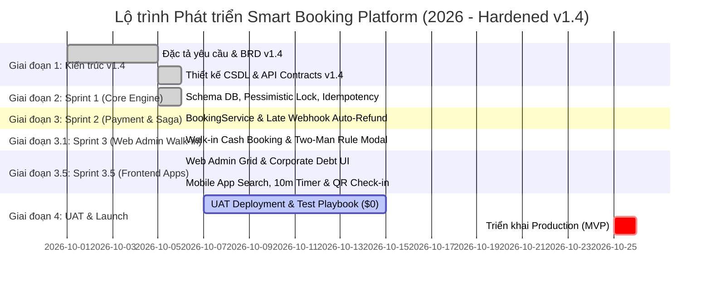

# Project Roadmap & Milestones

**Dự án:** Smart Meeting Room Booking System  
**Quản lý bởi:** @PM_Agent  
**Cập nhật lần cuối:** 2026-10-06  

---

## 1. Biểu đồ Kế hoạch Tổng thể (Mermaid Gantt Chart)

---

## 2. Các Cột mốc Quan trọng (Key Milestones)

| Cột mốc | Tên Milestone | Mục tiêu cần đạt | Hạn chót dự kiến | Trạng thái |
|---|---|---|---|---|
| **M1** | Architecture Freeze v1.4 | Hoàn thiện ERD, API specs v1.4, Two-Man Rule, Credit Limit, Outbox | 2026-10-05 | **COMPLETED** |
| **M2** | Core Booking Engine (Sprint 1) | Đặt chỗ không trùng lặp, cơ chế Redis Redlock, Pessimistic lock, QA locks test | 2026-10-06 | **COMPLETED** |
| **M3** | Payment & Saga Webhook (Sprint 2) | Hoàn tất tích hợp 4 cổng thanh toán, Late Webhook Saga Auto-Refund | 2026-10-06 | **COMPLETED** |
| **M4** | Web Admin Cash Walk-in (Sprint 3) | Walk-in Cash UI, OTP Quản lý ca trực duyệt hoàn tiền mặt, Cypress E2E | 2026-10-06 | **COMPLETED** |
| **M4.5** | **Frontend Client Apps (Sprint 3.5)** | **Hoàn thiện Mobile App (Expo) & Web Admin Grid/Debt UI trước khi UAT** | **2026-10-06** | **COMPLETED** |
| **M5** | **UAT Deployment & Testing (Stage 4)** | **Triển khai hạ tầng UAT $0 Free-Tier (Vercel, Render, Neon, Upstash) & Thực thi Kịch bản UAT** | **2026-10-15** | **ACTIVE (PLAYBOOK & DEPLOY READY)** |
| **M6** | Production Go-Live | Triển khai chính thức Production và bàn giao hệ thống | 2026-10-26 | **PENDING UAT SIGN-OFF** |

