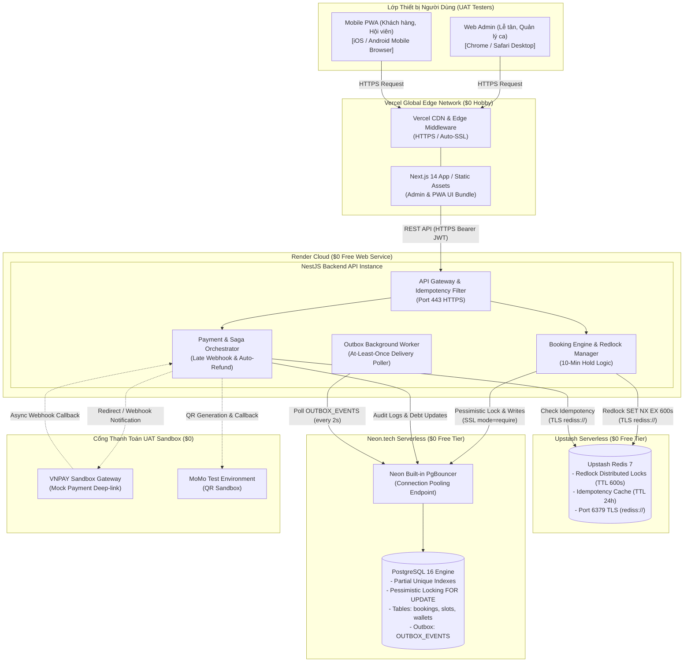

# 🌐 KIẾN TRÚC TRIỂN KHAI UAT CHI PHÍ 0 ĐỒNG ($0 ZERO-COST UAT ARCHITECTURE)

**Dự án:** Smart Meeting Room Booking System  
**Phiên bản hệ thống:** v1.4 Hardened (BRD v1.4)  
**Thiết kế bởi:** `@Architect_Agent`  
**Ngày lập:** 2026-10-07  
**Mục tiêu:** Thiết lập hạ tầng môi trường nghiệm thu người dùng (UAT) đáp ứng 100% các tính năng nghiệp vụ với ngân sách tuyệt đối **$0 (Zero-Cost)**, không phát sinh chi phí thẻ tín dụng bất ngờ, sẵn sàng phục vụ kiểm thử End-to-End.

---

## 1. Đánh giá & Lựa chọn Tech Stack $0 Free-Tier

Để triển khai toàn bộ hệ thống gồm Cơ sở dữ liệu quan hệ (PostgreSQL 16), Bộ nhớ đệm phân tán & Khóa khóa phân tán (Redis 7), Máy chủ API Backend (Node.js/NestJS), và Ứng dụng Giao diện Web Admin / Mobile PWA (Next.js/React), chúng tôi lựa chọn các nhà cung cấp đám mây uy tín có chính sách Free-Tier vĩnh viễn (hoặc hạn mức miễn phí hàng tháng đủ cho chu kỳ UAT 14–30 ngày):

| Thành phần | Nhà cung cấp lựa chọn | Gói cước (Tier) | Đặc tính & Thông số kỹ thuật | Lý do lựa chọn & So sánh |
|---|---|---|---|---|
| **Frontend Web Admin & PWA** | **Vercel** | Hobby Plan ($0/tháng) | • Băng thông: 100 GB/tháng • Edge Network toàn cầu, HTTPS tự động • Tích hợp CI/CD tự động từ GitHub • Không có thời gian khởi động nguội (Zero Cold Start) | Vượt trội hơn Netlify về khả năng tối ưu Next.js 14 App/Pages Router và Server-Side Rendering. |
| **Backend API (NestJS/Node)** | **Render** | Free Web Service ($0/tháng) | • 512 MB RAM, Shared vCPU • 750 giờ hoạt động miễn phí/tháng • Tự động cấp chứng chỉ TLS/SSL Let's Encrypt • Native Node.js runtime hỗ trợ WebSockets | Miễn phí không cần thẻ tín dụng, hỗ trợ triển khai trực tiếp từ Dockerfile hoặc git repository. |
| **Cơ sở dữ liệu (Database)** | **Neon.tech** | Serverless Postgres ($0/tháng) | • PostgreSQL 16 Native • 0.5 GiB lưu trữ SSD NVMe • Tích hợp sẵn PgBouncer Connection Pooling • Hỗ trợ Partial Unique Index, Row Locks, Check Constraints | Vượt trội hơn Supabase Free ở tính năng Autoscaling Serverless và PgBouncer mặc định không gây nghẽn kết nối. |
| **Cache & Lock Manager** | **Upstash** | Serverless Redis ($0/tháng) | • 10,000 lệnh (commands) / ngày • 256 MB RAM lưu trữ • Kết nối chuẩn Redis TCP (TLS `rediss://`) & REST API • Lưu trữ bền vững (Data Persistence) | Hỗ trợ chuẩn các lệnh `SET NX EX`, Redlock 10-minute hold và Idempotency 24h mà không yêu cầu server chạy thường trực. |
| **Outbox Relay & Queue** | **Transactional Outbox in Neon** | Tích hợp sẵn ($0) | • Bảng `OUTBOX_EVENTS` trên Postgres • Background Poller chạy ngầm trong NestJS API | Tiết kiệm chi phí thuê Cloud RabbitMQ/Kafka; đảm bảo độ tin cậy At-Least-Once Delivery mà không tốn tài nguyên bên ngoài. |

---

## 2. Hạn chế của Free-Tier & Chiến lược Phòng vệ (Limitations & Mitigations)

Do đặc thù môi trường miễn phí, hạ tầng có các rào cản kỹ thuật cần được xử lý thông qua cấu hình phần mềm và quy trình kiểm thử:

### 2.1. Hiện tượng Khởi động nguội của Render (Cold Starts)
* **Hạn chế:** Render Free Web Service sẽ tự động chuyển sang chế độ "ngủ" (Sleep) sau **15 phút** không có lưu lượng truy cập (Inactivity). Request đầu tiên sau khi ngủ sẽ mất từ **40 – 50 giây** để khởi động container.
* **Tác động UAT:** Tester có thể tưởng nhầm hệ thống bị treo hoặc timeout khi truy cập lần đầu.
* **Giải pháp phòng vệ:**
  1. **Pre-warming Ping:** Sử dụng dịch vụ giám sát miễn phí (như UptimeRobot hoặc cron job cURL mỗi 10 phút vào khung giờ hành chính 08:00 – 18:00) để giữ service luôn hoạt động trong các buổi UAT tập trung.
  2. **Giao diện Client UX:** Frontend hiển thị thông báo thân thiện: *"Máy chủ UAT đang khởi động kết nối an toàn (ước tính 30s), vui lòng chờ trong giây lát..."* nếu API phản hồi quá 5s.

### 2.2. Tự động đóng kết nối của Neon Postgres (Compute Auto-Suspend)
* **Hạn chế:** Neon Serverless sẽ tạm ngưng compute sau 5 phút không có truy vấn để tiết kiệm tài nguyên. Thời gian kích hoạt lại mất từ **300ms – 1s**.
* **Giải pháp phòng vệ:**
  * Bắt buộc sử dụng chuỗi kết nối **Pooled Connection String** (`-pooler` endpoint) đi qua PgBouncer nội bộ của Neon.
  * Cấu hình TypeORM/Prisma trong NestJS với `max: 10`, `idleTimeoutMillis: 30000`, và bật `keepAlive: true`.

### 2.3. Hạn mức 10,000 lệnh/ngày của Upstash Redis
* **Hạn chế:** Nếu vượt quá 10,000 lệnh/ngày, Upstash sẽ chặn các thao tác tiếp theo.
* **Định lượng kiểm thử:** Một lượt đặt phòng hoàn chỉnh tiêu tốn khoảng 8–12 lệnh Redis (Idempotency check, Set Lock NX EX, Get Remaining Time, Release Lock). Hạn mức 10,000 lệnh cho phép thực hiện gần **1,000 lượt đặt phòng/ngày**, hoàn toàn thừa thãi cho quy mô đội UAT nội bộ (5–10 testers).
* **Giải pháp phòng vệ:**
  * Chỉ lưu trữ dữ liệu thiết yếu trên Redis: Khóa phòng Redlock (`booking:lock:{slot_id}`) và Idempotency Hash (`idempotency:{key}`).
  * Thiết lập TTL chính xác (Khóa: 600s, Idempotency: 86400s) để Redis tự động giải phóng bộ nhớ, không giữ khóa rác.

---

## 3. Sơ đồ Kiến trúc Triển khai UAT (Mermaid Deployment Diagram)

Kiến trúc phân tán giữa các dịch vụ đám mây miễn phí được kết nối bảo mật qua giao thức mã hóa HTTPS/TLS:

---

## 4. Ma trận Ranh giới An toàn & Cô lập Dữ liệu (Security & Isolation)

1. **Bảo mật Kết nối (Encryption in Transit):**
   * 100% traffic công khai giữa Browser và Vercel/Render chạy trên **HTTPS (TLS 1.3)**.
   * Kết nối tới Upstash Redis bắt buộc dùng tiền tố **`rediss://`** (TLS trên cổng 6379).
   * Kết nối tới Neon Postgres bắt buộc tham số **`?sslmode=require`**.
2. **Cô lập Môi trường (Environment Segregation):**
   * Cơ sở dữ liệu UAT hoàn toàn tách biệt với dữ liệu thật. Dữ liệu tài khoản thẻ test và ví điện tử sử dụng số dư giả lập (Mock Credits).
   * Khóa bí mật `JWT_SECRET` và `IDEMPOTENCY_SALT` của môi trường UAT được sinh ngẫu nhiên 64 ký tự hex độc lập.
3. **Cơ chế Fallback Khi Chạm Giới hạn:**
   * Trong trường hợp Render hoặc Upstash bị nghẽn trong đợt kiểm thử tải cao, Tester có thể chuyển hướng ngay lập tức về môi trường **Docker Compose Local UAT** được tài liệu hóa chi tiết tại [05-deployment/docker-compose.local-uat.yml](file:///home/nam/smart-booking-project/smart-booking-project/05-deployment/docker-compose.local-uat.yml).
